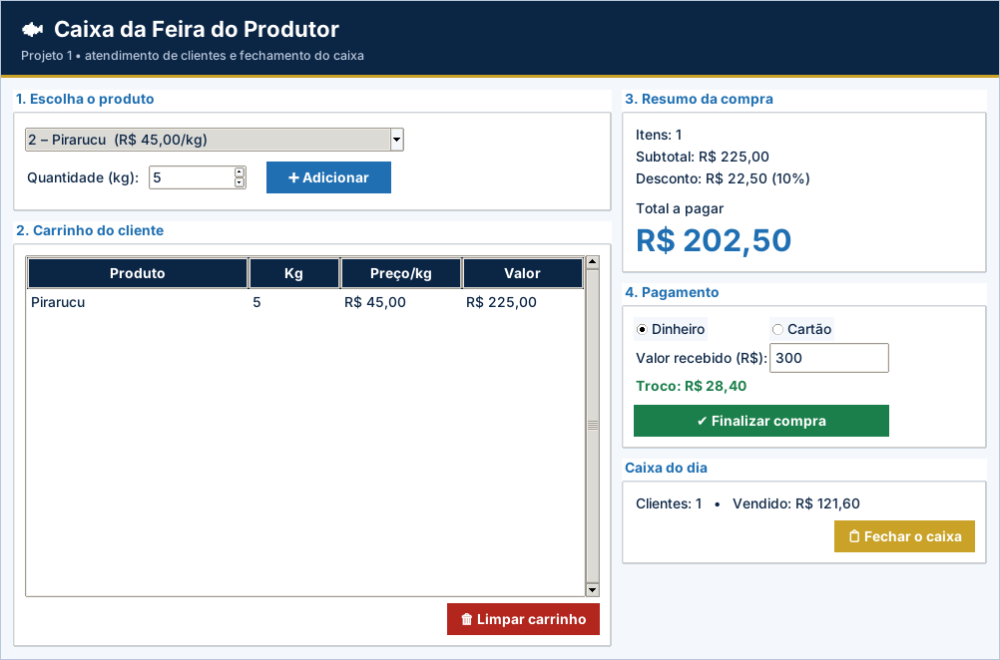

# Gabarito e correção – Projeto 1: Caixa da Feira do Produtor

> Uso exclusivo do professor. A atribuição de notas é de sua competência.

## Como corrigir

1. Copie o `logica.py` do aluno para uma pasta com `app.py`, `testes_logica.py` e `ui_comum.py` deste projeto.
2. Rode `python ../corrigir.py <pasta>` (ou `python -m unittest -v testes_logica.py`).
3. Abra `python app.py` e confira o funcionamento na tela.

## Casos de teste

| Situação testada | Resultado esperado |
| --- | --- |
| Quantidade 0 ou negativa | ValueError “A quantidade deve ser maior que zero.” |
| Subtotal R$ 99,99 / 100,00 / 199,99 / 200,00 | Desconto 0% / 5% / 5% / 10% |
| 2 kg Tambaqui + 1 kg Pirarucu (R$ 101,00) | Desconto R$ 5,05 e total R$ 95,95 |
| 5 kg Pirarucu (R$ 225,00) | Desconto R$ 22,50 (10%) e total R$ 202,50 |
| Finalizar com carrinho vazio | Aviso “Registre ao menos um item.” |
| Dinheiro: total 95,95 e recebido 100,00 | Troco R$ 4,05 |
| Dinheiro: total 95,95 e recebido 90,00 | Aviso “Faltam R$ 5.95.” e a compra não é finalizada |
| Dois clientes atendidos (95,95 e 56,00) | Fechamento: 2 clientes, R$ 151,95 |

## Matriz de correção

| Critério | Pleno | Parcial | Insuficiente |
| --- | --- | --- | --- |
| Funcionamento | Os 10 testes passam e a tela conclui uma compra completa. | Passam de 5 a 9 testes ou há falha em uma etapa da tela. | Menos de 5 testes passam ou a tela não funciona. |
| Regras de desconto | Faixas e limites (100 e 200) corretos. | Erra um limite (ex.: usa `>` em vez de `>=`). | Desconto incorreto ou ausente. |
| Validações | Quantidade, carrinho vazio e troco tratados com `ValueError`. | Trata parte das validações. | Sem validações. |
| Uso dos conteúdos | Funções, decisões, `sum`, arredondamento e listas bem aplicados. | Código repetitivo, mas correto. | Sem funções ou sem decisões. |
| Organização | Legível, comentado, nomes claros. | Pouco comentado. | Desorganizado. |

## Erros frequentes

- Usar `subtotal > 100` (o limite é inclusivo: R$ 100,00 já tem 5%).
- Esquecer `round(..., 2)` e exibir valores como 95.94999999.
- Calcular o desconto sobre o total em vez do subtotal.
- Retornar o troco negativo em vez de gerar `ValueError` quando o valor recebido é menor.
- Usar `return` dentro do `for` da soma, somando só o primeiro item.

## Orientações para os desafios extras

- **Nota do cliente:** `with open("nota_cliente.txt", "w", encoding="utf-8") as f:` e um `for` sobre `self.itens`.
- **Gráfico:** dicionário `{produto: kg}`; `canvas.create_rectangle(x, base - kg * escala, x + 40, base)`.
- **Atalho:** `entrada.bind("<Return>", lambda e: self.adicionar())`.

## Resultado dos testes do gabarito

```text
test_faixas_de_desconto (testes_logica.TestCaixa.test_faixas_de_desconto) ... ok
test_fechamento (testes_logica.TestCaixa.test_fechamento) ... ok
test_quantidade_valida_e_invalida (testes_logica.TestCaixa.test_quantidade_valida_e_invalida) ... ok
test_resumo_com_10_por_cento (testes_logica.TestCaixa.test_resumo_com_10_por_cento) ... ok
test_resumo_com_5_por_cento (testes_logica.TestCaixa.test_resumo_com_5_por_cento) ... ok
test_resumo_sem_desconto (testes_logica.TestCaixa.test_resumo_sem_desconto) ... ok
test_resumo_sem_itens (testes_logica.TestCaixa.test_resumo_sem_itens) ... ok
test_troco (testes_logica.TestCaixa.test_troco) ... ok
test_troco_insuficiente (testes_logica.TestCaixa.test_troco_insuficiente) ... ok
test_valor_item (testes_logica.TestCaixa.test_valor_item) ... ok

----------------------------------------------------------------------
Ran 10 tests in 0.000s

OK
```

## Tela do gabarito


