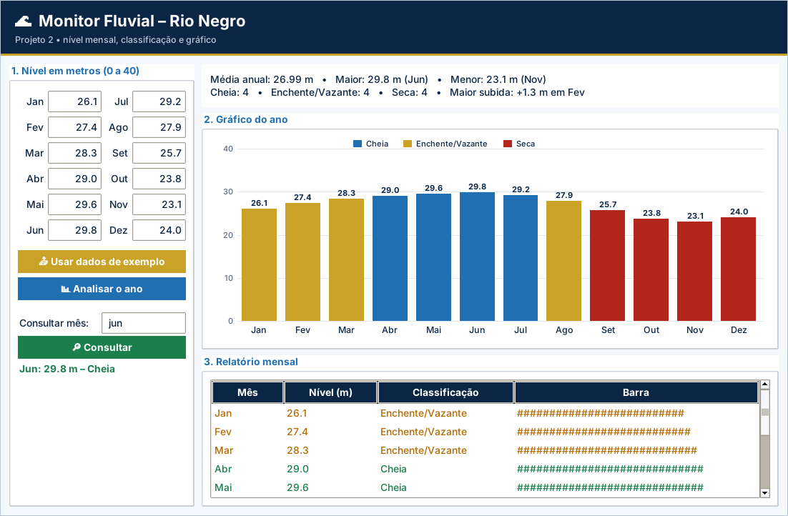

# Gabarito e correção – Projeto 2: Monitor Fluvial: Nível do Rio Negro

> Uso exclusivo do professor. A atribuição de notas é de sua competência.

## Como corrigir

1. Copie o `logica.py` do aluno para uma pasta com `app.py`, `testes_logica.py` e `ui_comum.py` deste projeto.
2. Rode `python ../corrigir.py <pasta>` (ou `python -m unittest -v testes_logica.py`).
3. Abra `python app.py` e confira o funcionamento na tela.

## Casos de teste

| Situação testada | Resultado esperado |
| --- | --- |
| Nível 45 em Janeiro | ValueError “Valor inválido! Digite entre 0 e 40 metros.” |
| Dados de exemplo (26,1 … 24,0) | Média 26,99 m; maior 29,8 m em Jun; menor 23,1 m em Nov |
| Classificação dos 12 meses | Cheia 4 (Abr–Jul); Enchente/Vazante 4; Seca 4 |
| Maior subida | +1,3 m em Fev |
| Nível 29,0 / 28,99 / 26,0 / 25,99 | Cheia / Enchente-Vazante / Enchente-Vazante / Seca |
| Consulta “  jun ” | Jun: 29,8 m – Cheia |
| Consulta “xyz” | “Mês não encontrado.” |
| Série sempre descendo | Maior subida (0.0, "") |

## Matriz de correção

| Critério | Pleno | Parcial | Insuficiente |
| --- | --- | --- | --- |
| Funcionamento | Os 7 testes passam e o gráfico reflete os dados. | Passam de 4 a 6 testes ou há falha em uma etapa da tela. | Menos de 4 testes passam ou a tela não funciona. |
| Estruturas de dados | Listas paralelas e dicionário contador corretos. | Usa listas, mas com índices frágeis. | Variáveis soltas. |
| Regras de negócio | Faixas, limites e maior subida corretos. | Erro em um limite. | Classificação incorreta. |
| Strings | Consulta padronizada com `strip()` e `title()`. | Padroniza só parte dos casos. | Busca falha com maiúsculas e espaços. |
| Organização | Legível e comentado. | Pouco comentado. | Desorganizado. |

## Erros frequentes

- Inicializar `maior_subida` com o primeiro nível em vez de 0, registrando subidas nulas ou negativas.
- Usar `range(12)` fixo em vez de `range(len(niveis))`.
- Esquecer que `index()` devolve a primeira ocorrência (empates) e não avisar.
- Comparar `nivel > 29` em vez de `>= 29` na classificação.
- Esquecer `.title()` e não encontrar “jun” ou “JUN”.

## Orientações para os desafios extras

- **Linha:** monte a lista de coordenadas e use `canvas.create_line(*pontos, fill=BLUE, width=3)`.
- **Críticos:** `[m for m, n in zip(MESES, niveis) if n < 24]`.
- **Segundo ano:** repita o cálculo de x e desenhe com outra cor; adicione legenda.

## Resultado dos testes do gabarito

```text
test_barra (testes_logica.TestMonitor.test_barra) ... ok
test_classificar_limites (testes_logica.TestMonitor.test_classificar_limites) ... ok
test_consulta (testes_logica.TestMonitor.test_consulta) ... ok
test_contagem (testes_logica.TestMonitor.test_contagem) ... ok
test_estatisticas (testes_logica.TestMonitor.test_estatisticas) ... ok
test_maior_subida (testes_logica.TestMonitor.test_maior_subida) ... ok
test_validar_nivel (testes_logica.TestMonitor.test_validar_nivel) ... ok

----------------------------------------------------------------------
Ran 7 tests in 0.001s

OK
```

## Tela do gabarito


