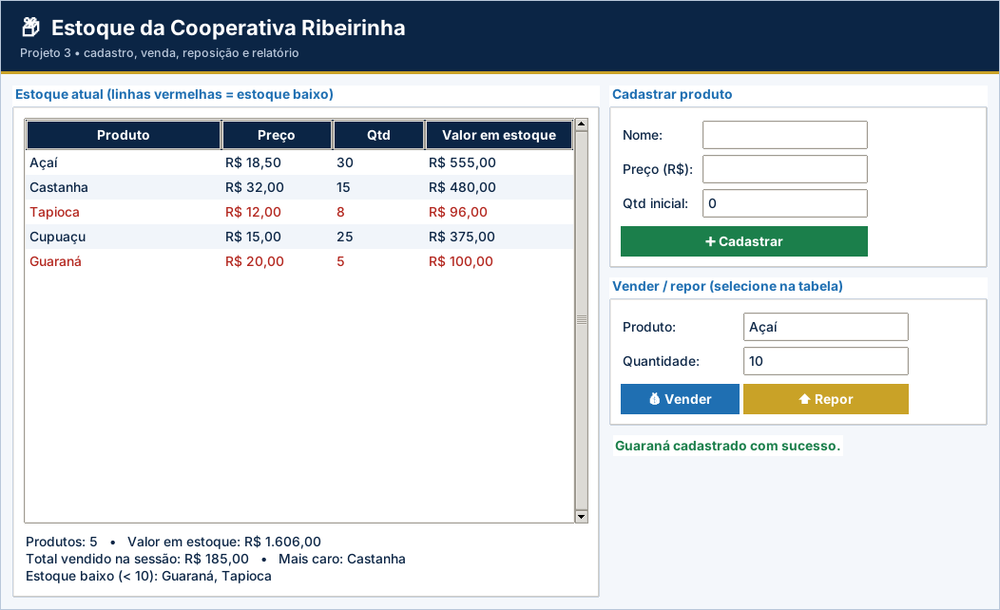

# Gabarito e correção – Projeto 3: Estoque da Cooperativa Ribeirinha

> Uso exclusivo do professor. A atribuição de notas é de sua competência.

## Como corrigir

1. Copie o `logica.py` do aluno para uma pasta com `app.py`, `testes_logica.py` e `ui_comum.py` deste projeto.
2. Rode `python ../corrigir.py <pasta>` (ou `python -m unittest -v testes_logica.py`).
3. Abra `python app.py` e confira o funcionamento na tela.

## Casos de teste

| Situação testada | Resultado esperado |
| --- | --- |
| Cadastrar “  guaraná ” a R$ 20,00 com 5 un. | Cadastra como “Guaraná” |
| Cadastrar nome vazio, repetido, preço 0 ou quantidade -1 | `ValueError` em cada caso e estoque inalterado |
| Vender 10 un. de Açaí | R$ 185,00 e estoque 30 |
| Vender produto inexistente, 0 un. ou mais que o estoque | `ValueError`; estoque inalterado |
| Repor 12 un. de Tapioca | Estoque passa de 8 para 20 |
| Estoque baixo com 9 e com 10 un. | 9 é baixo; 10 não é |
| Valor total inicial | R$ 1.691,00 |
| Relatório inicial | 4 produtos; mais caro Castanha; baixo: Tapioca |

## Matriz de correção

| Critério | Pleno | Parcial | Insuficiente |
| --- | --- | --- | --- |
| Funcionamento | Os 9 testes passam e a tela atualiza após cada operação. | Passam de 5 a 8 testes ou há falha em uma etapa da tela. | Menos de 5 testes passam ou a tela não funciona. |
| Dicionários aninhados | `estoque[nome]["qtd"]` e `["preco"]` usados corretamente. | Usa, mas com duplicação. | Não usa dicionários. |
| Funções | Todas as funções com parâmetros e retorno corretos. | Parte usa variáveis globais. | Sem funções. |
| Validações | Todas as regras RN01–RN06 verificadas. | Falta uma ou duas. | Sem validações. |
| Organização | Legível e comentado. | Pouco comentado. | Desorganizado. |

## Erros frequentes

- Padronizar o nome só no cadastro e não na venda/reposição (“açaí” não é encontrado).
- Baixar o estoque antes de validar e deixar o dicionário alterado quando há erro.
- Usar `<= MINIMO` no estoque baixo (10 unidades não é baixo).
- Devolver o estoque inicial como variável global compartilhada (os testes passam a interferir).
- Calcular `valor_total` sem arredondar.

## Orientações para os desafios extras

- **CSV:** `f.write("produto;preco;qtd\n")` e uma linha por produto.
- **Ordenar:** `tv.heading(col, command=lambda c=col: self.ordenar(c))` e `sorted(..., key=...)`.
- **Status:** acrescente uma coluna em `tabela(...)` e preencha com `"BAIXO" if qtd < logica.MINIMO else "OK"`.

## Resultado dos testes do gabarito

```text
test_cadastrar (testes_logica.TestEstoque.test_cadastrar) ... ok
test_cadastrar_invalidos (testes_logica.TestEstoque.test_cadastrar_invalidos) ... ok
test_estoque_inicial_novo_a_cada_chamada (testes_logica.TestEstoque.test_estoque_inicial_novo_a_cada_chamada) ... ok
test_padronizar (testes_logica.TestEstoque.test_padronizar) ... ok
test_relatorio (testes_logica.TestEstoque.test_relatorio) ... ok
test_repor (testes_logica.TestEstoque.test_repor) ... ok
test_valor_total_e_baixo (testes_logica.TestEstoque.test_valor_total_e_baixo) ... ok
test_vender (testes_logica.TestEstoque.test_vender) ... ok
test_vender_invalidos (testes_logica.TestEstoque.test_vender_invalidos) ... ok

----------------------------------------------------------------------
Ran 9 tests in 0.001s

OK
```

## Tela do gabarito


