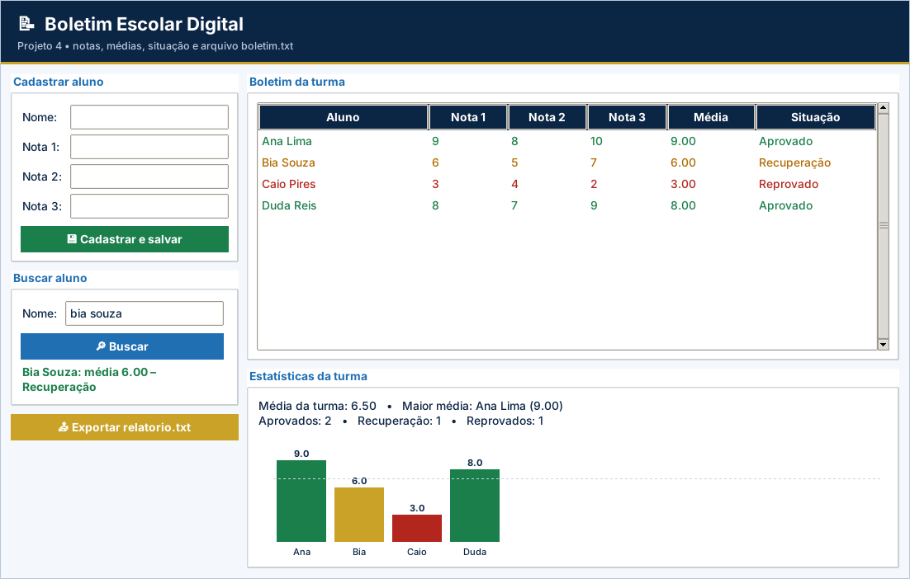

# Gabarito e correção – Projeto 4: Boletim Escolar Digital

> Uso exclusivo do professor. A atribuição de notas é de sua competência.

## Como corrigir

1. Copie o `logica.py` do aluno para uma pasta com `app.py`, `testes_logica.py` e `ui_comum.py` deste projeto.
2. Rode `python ../corrigir.py <pasta>` (ou `python -m unittest -v testes_logica.py`).
3. Abra `python app.py` e confira o funcionamento na tela.

## Casos de teste

| Situação testada | Resultado esperado |
| --- | --- |
| Notas 8, 7 e 6 | Média 7,00 – Aprovado (limite inclusivo) |
| Média 6,99 / 5,00 / 4,99 | Recuperação / Recuperação / Reprovado |
| Nota -1 ou 10,1 | `ValueError` de nota inválida |
| Nome vazio, com “;” ou repetido (“MARIA”) | `ValueError`; lista inalterada |
| Busca “  ANA lima ” | Encontra “Ana Lima” |
| Estatísticas com Ana 9,0 / Bia 6,0 / Caio 3,0 | Média da turma 6,00; melhor Ana; 1 em cada situação |
| Estatísticas com lista vazia | “Nenhum aluno cadastrado.” sem erro de divisão |
| Salvar, reabrir e exportar | Dados permanecem; `relatorio.txt` com `nome;média;situação` |

## Matriz de correção

| Critério | Pleno | Parcial | Insuficiente |
| --- | --- | --- | --- |
| Funcionamento | Os 7 testes passam e os dados permanecem ao reabrir a tela. | Passam de 4 a 6 testes ou há falha em uma etapa da tela. | Menos de 4 testes passam ou a tela não funciona. |
| Arquivos | Leitura e escrita corretas, `strip()` e `split(";")`. | Grava, mas não carrega (ou o contrário). | Não usa arquivo. |
| Estruturas de dados | Lista de dicionários bem manipulada. | Usa listas paralelas. | Sem estrutura. |
| Regras de negócio | Faixas, nome e notas corretas. | Erro em um limite. | Situação incorreta. |
| Organização | Legível e comentado. | Pouco comentado. | Desorganizado. |

## Erros frequentes

- Gravar com o modo `"a"` e duplicar os alunos a cada salvamento.
- Esquecer o `strip()` ao ler o arquivo e deixar `\n` no último campo.
- Converter as notas com `int()` ao carregar (perde casas decimais).
- Dividir pela quantidade de alunos sem tratar a lista vazia.
- Comparar o nome sem padronizar (“maria” ≠ “Maria”).

## Orientações para os desafios extras

- **Ranking:** `sorted(alunos, key=lambda a: calcular_media(a["notas"]), reverse=True)`.
- **Filtro:** `[a for a in alunos if situacao(calcular_media(a["notas"])) == escolhido]`.
- **Pizza:** ângulo = `360 * qtd / total`; `canvas.create_arc(..., start=inicio, extent=angulo, fill=cor)`.

## Resultado dos testes do gabarito

```text
test_buscar (testes_logica.TestBoletim.test_buscar) ... ok
test_cadastro (testes_logica.TestBoletim.test_cadastro) ... ok
test_cadastro_invalidos (testes_logica.TestBoletim.test_cadastro_invalidos) ... ok
test_estatisticas (testes_logica.TestBoletim.test_estatisticas) ... ok
test_media_e_situacao (testes_logica.TestBoletim.test_media_e_situacao) ... ok
test_persistencia_e_relatorio (testes_logica.TestBoletim.test_persistencia_e_relatorio) ... ok
test_validar_nota (testes_logica.TestBoletim.test_validar_nota) ... ok

----------------------------------------------------------------------
Ran 7 tests in 0.001s

OK
```

## Tela do gabarito


