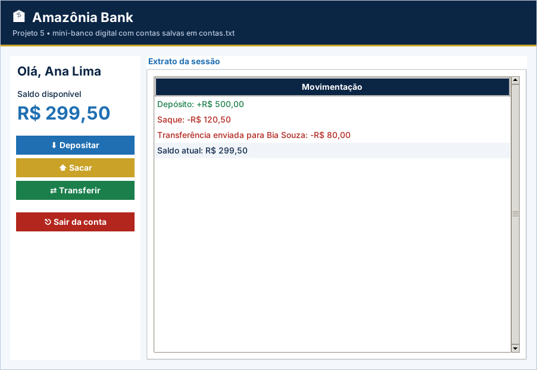

# Gabarito e correção – Projeto 5: Amazônia Bank: Mini-Banco Digital

> Uso exclusivo do professor. A atribuição de notas é de sua competência.

## Como corrigir

1. Copie o `logica.py` do aluno para uma pasta com `app.py`, `testes_logica.py` e `ui_comum.py` deste projeto.
2. Rode `python ../corrigir.py <pasta>` (ou `python -m unittest -v testes_logica.py`).
3. Abra `python app.py` e confira o funcionamento na tela.

## Casos de teste

| Situação testada | Resultado esperado |
| --- | --- |
| Criar conta “  ana lima ” senha 1234 | Titular “Ana Lima”, saldo 0 |
| Titular vazio, com “;” ou repetido; senha 123, 12345 ou 12a4 | `ValueError` em cada caso |
| Login com senha errada ou titular inexistente | “Titular ou senha inválidos.” |
| Depositar 100 e sacar 30,50 | Saldo R$ 69,50 e histórico com as duas linhas |
| Depositar 0 / sacar acima do saldo | `ValueError`; saldo inalterado |
| Transferir R$ 50 de Ana para Bia | Ana -50, Bia +50 e histórico nas duas contas |
| Transferir para si mesmo | `ValueError` |
| Salvar e carregar contas | Linha `titular;senha;saldo`; saldo preservado; histórico vazio |

## Matriz de correção

| Critério | Pleno | Parcial | Insuficiente |
| --- | --- | --- | --- |
| Funcionamento | Os 9 testes passam e o fluxo login → operação → extrato funciona. | Passam de 5 a 8 testes ou há falha em uma etapa da tela. | Menos de 5 testes passam ou a tela não funciona. |
| Orientação a objetos | Classe `Conta` com atributos e métodos coerentes. | Usa a classe, mas com funções soltas. | Sem classe. |
| Regras de negócio | RN01–RN07 todas atendidas. | Falha em uma regra (ex.: transferência para si). | Operações sem validação. |
| Persistência | Salva após cada operação e carrega ao abrir. | Salva, mas não carrega corretamente. | Não persiste. |
| Organização | Legível e comentado. | Pouco comentado. | Desorganizado. |

## Erros frequentes

- Esquecer o `self` nos atributos (`saldo = 0` em vez de `self.saldo = 0`).
- Na transferência, descontar da origem antes de validar o destino.
- Registrar o histórico só na conta de origem.
- Comparar a senha como número (`1234 == "1234"`); a senha é texto.
- Gravar o saldo sem formatar com duas casas e perder precisão visual.

## Orientações para os desafios extras

- **Tentativas:** contador no `BancoApp`; `self.root.after(30000, liberar)` para o desbloqueio.
- **Alterar senha:** novo método `Conta.alterar_senha(atual, nova)` com as mesmas validações da RN02.
- **Extrato:** `"\n".join(conta.extrato())` gravado com `open(..., "w")`.

## Resultado dos testes do gabarito

```text
test_criar_conta (testes_logica.TestBanco.test_criar_conta) ... ok
test_criar_conta_invalida (testes_logica.TestBanco.test_criar_conta_invalida) ... ok
test_deposito_e_saque (testes_logica.TestBanco.test_deposito_e_saque) ... ok
test_entrar (testes_logica.TestBanco.test_entrar) ... ok
test_extrato (testes_logica.TestBanco.test_extrato) ... ok
test_formatar (testes_logica.TestBanco.test_formatar) ... ok
test_persistencia (testes_logica.TestBanco.test_persistencia) ... ok
test_transferencia (testes_logica.TestBanco.test_transferencia) ... ok
test_transferencia_invalida (testes_logica.TestBanco.test_transferencia_invalida) ... ok

----------------------------------------------------------------------
Ran 9 tests in 0.001s

OK
```

## Tela do gabarito


