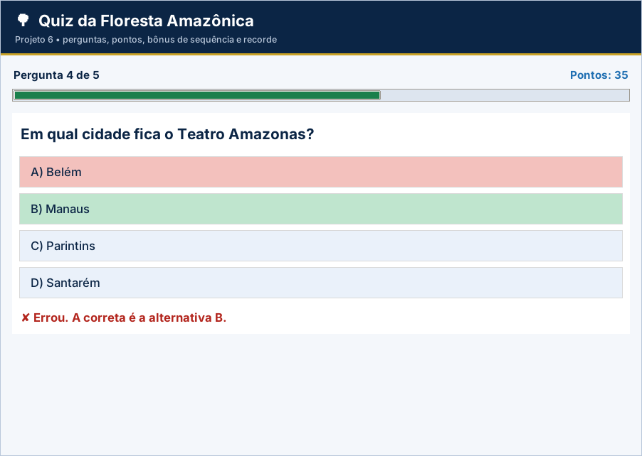

# Gabarito e correção – Projeto 6: Quiz da Floresta Amazônica

> Uso exclusivo do professor. A atribuição de notas é de sua competência.

## Como corrigir

1. Copie o `logica.py` do aluno para uma pasta com `app.py`, `testes_logica.py` e `ui_comum.py` deste projeto.
2. Rode `python ../corrigir.py <pasta>` (ou `python -m unittest -v testes_logica.py`).
3. Abra `python app.py` e confira o funcionamento na tela.

## Casos de teste

| Situação testada | Resultado esperado |
| --- | --- |
| Resposta “b”, “ B ” e “B” | Todas aceitas como B |
| Resposta “x”, vazia ou “AB” | `ValueError`; sem penalidade |
| Acerta, acerta, acerta, erra, acerta | 45 pontos (30 + 5 de bônus + 10) |
| Erra tudo | 0 ponto – Aprendiz |
| Acerta tudo | 55 pontos – Guardião da Floresta (um único bônus) |
| Acerta, acerta, erra, acerta, acerta | 40 pontos (o erro zera a sequência) |
| 49 / 50 pontos | Explorador / Guardião da Floresta |
| Segunda partida com 45 (recorde 45) | Não é novo recorde |

## Matriz de correção

| Critério | Pleno | Parcial | Insuficiente |
| --- | --- | --- | --- |
| Funcionamento | Os 9 testes passam e a partida completa funciona na tela. | Passam de 5 a 8 testes ou há falha em uma etapa da tela. | Menos de 5 testes passam ou a tela não funciona. |
| Pontuação | Pontos, bônus e zeragem da sequência corretos. | Bônus com falha. | Pontuação incorreta. |
| Validação | Resposta tratada conforme RN01. | Não aceita minúscula. | Sem validação. |
| Uso dos conteúdos | `for`, `if/elif`, acumuladores e contadores bem aplicados. | Repete código. | Sem repetição. |
| Organização | Legível e comentado. | Pouco comentado. | Desorganizado. |

## Erros frequentes

- Não zerar `seguidos` depois do bônus (o 4º acerto recebe bônus indevido).
- Validar com `resposta != "A" or resposta != "B"` (sempre verdadeiro).
- Esquecer `.upper()` e tratar “b” como erro.
- Comparar `pontos > 50` em vez de `>= 50` no título.
- Não zerar os acumuladores ao começar nova partida.

## Orientações para os desafios extras

- **Cronômetro:** guarde o `id` de `root.after(15000, self.tempo_esgotado)` e cancele com `after_cancel` ao responder.
- **Sorteio:** `import random` e `random.sample(logica.PERGUNTAS, 5)`.
- **Som:** chame `self.root.bell()` no ramo do erro.

## Resultado dos testes do gabarito

```text
test_banco_de_perguntas (testes_logica.TestQuiz.test_banco_de_perguntas) ... ok
test_conferir (testes_logica.TestQuiz.test_conferir) ... ok
test_erro_zera_sequencia (testes_logica.TestQuiz.test_erro_zera_sequencia) ... ok
test_pontos_55 (testes_logica.TestQuiz.test_pontos_55) ... ok
test_pontos_partida_45 (testes_logica.TestQuiz.test_pontos_partida_45) ... ok
test_pontos_zero (testes_logica.TestQuiz.test_pontos_zero) ... ok
test_recorde (testes_logica.TestQuiz.test_recorde) ... ok
test_titulos (testes_logica.TestQuiz.test_titulos) ... ok
test_validar_resposta (testes_logica.TestQuiz.test_validar_resposta) ... ok

----------------------------------------------------------------------
Ran 9 tests in 0.000s

OK
```

## Tela do gabarito


