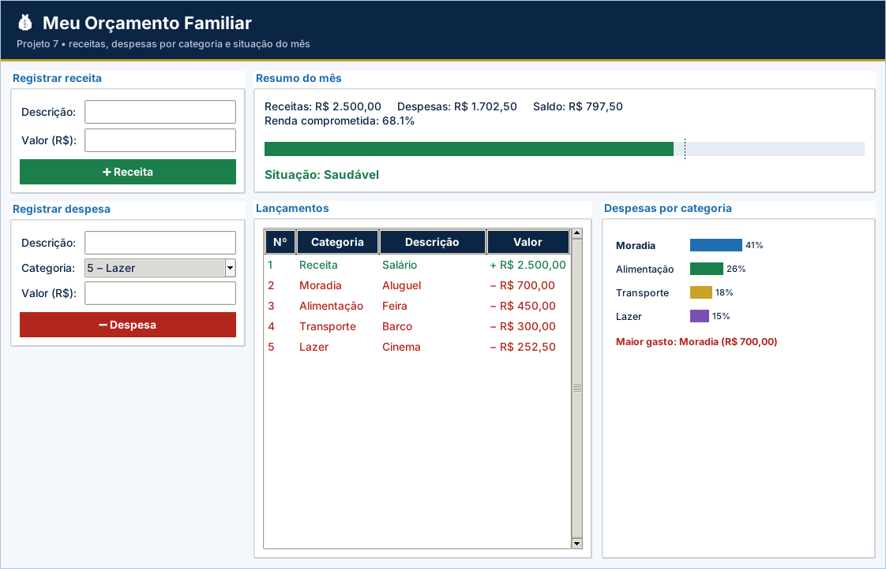

# Gabarito e correção – Projeto 7: Meu Orçamento Familiar

> Uso exclusivo do professor. A atribuição de notas é de sua competência.

## Como corrigir

1. Copie o `logica.py` do aluno para uma pasta com `app.py`, `testes_logica.py` e `ui_comum.py` deste projeto.
2. Rode `python ../corrigir.py <pasta>` (ou `python -m unittest -v testes_logica.py`).
3. Abra `python app.py` e confira o funcionamento na tela.

## Casos de teste

| Situação testada | Resultado esperado |
| --- | --- |
| Receita “  salário  ” de R$ 2.500 | Descrição “Salário”, categoria “Receita” |
| Descrição vazia, valor 0 ou categoria 0 / 7 | `ValueError` em cada caso |
| Exemplo: receita 2.500 e despesas 700 + 450 + 300 + 252,50 | Despesas 1.702,50; saldo 797,50; 68,1% – Saudável |
| 70% / 70,01% / 100% / 120% | Saudável / Atenção / Atenção / Alerta |
| Sem receitas | Percentual `None` e aviso para registrar receita (sem divisão por zero) |
| Categorias do exemplo | Moradia, Alimentação, Transporte e Lazer; maior gasto Moradia R$ 700,00 |
| Percentuais por categoria | Somam 100% |
| Só receitas lançadas | Despesas por categoria vazio |

## Matriz de correção

| Critério | Pleno | Parcial | Insuficiente |
| --- | --- | --- | --- |
| Funcionamento | Os 6 testes passam e os gráficos acompanham os lançamentos. | Passam de 3 a 5 testes ou há falha em uma etapa da tela. | Menos de 3 testes passam ou a tela não funciona. |
| Estruturas de dados | Lista de dicionários e dicionário de totais corretos. | Usa listas simples. | Sem estrutura. |
| Regras de negócio | RN01–RN06 atendidas (limites 70 e 100 inclusivos). | Erro em um limite. | Situação incorreta. |
| Validação | Descrição, valor e categoria validados. | Valida parte. | Sem validação. |
| Organização | Legível e comentado. | Pouco comentado. | Desorganizado. |

## Erros frequentes

- Dividir por `receitas` sem testar zero (`ZeroDivisionError`).
- Usar `CATEGORIAS[numero]` em vez de `CATEGORIAS[numero - 1]`.
- Somar receitas nas categorias de despesa por não filtrar o `tipo`.
- Comparar `percentual < 70` quando o limite é inclusivo (`<= 70`).
- Acumular os totais entre chamadas por não zerar o dicionário.

## Orientações para os desafios extras

- **Pizza:** para cada categoria, `extent = 360 * pct / 100` e `start` acumulado.
- **Meta:** `if saldo >= meta:` e mostre o resultado em um `Label`.
- **Remover:** `self.lancamentos.pop(int(tv.item(sel[0], "values")[0]) - 1)`.

## Resultado dos testes do gabarito

```text
test_categorias (testes_logica.TestOrcamento.test_categorias) ... ok
test_despesas_nao_incluem_receitas (testes_logica.TestOrcamento.test_despesas_nao_incluem_receitas) ... ok
test_lancamento_invalido (testes_logica.TestOrcamento.test_lancamento_invalido) ... ok
test_novo_lancamento (testes_logica.TestOrcamento.test_novo_lancamento) ... ok
test_percentual_e_situacao (testes_logica.TestOrcamento.test_percentual_e_situacao) ... ok
test_totais (testes_logica.TestOrcamento.test_totais) ... ok

----------------------------------------------------------------------
Ran 6 tests in 0.000s

OK
```

## Tela do gabarito


