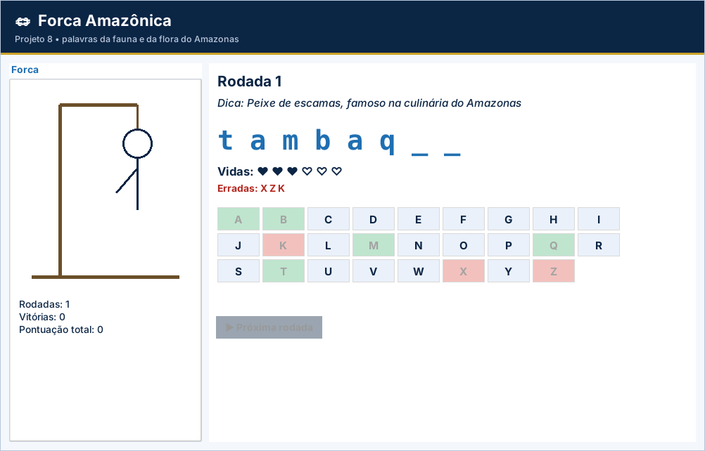

# Gabarito e correção – Projeto 8: Forca Amazônica

> Uso exclusivo do professor. A atribuição de notas é de sua competência.

## Como corrigir

1. Copie o `logica.py` do aluno para uma pasta com `app.py`, `testes_logica.py` e `ui_comum.py` deste projeto.
2. Rode `python ../corrigir.py <pasta>` (ou `python -m unittest -v testes_logica.py`).
3. Abra `python app.py` e confira o funcionamento na tela.

## Casos de teste

| Situação testada | Resultado esperado |
| --- | --- |
| Letra “ A ” | Aceita como “a” |
| Vazia, “ab”, “1”, “ç” | `ValueError` |
| Letra repetida | `ValueError` sem perder vida |
| Exibição de “pirarucu” com r e u | `_ _ r _ r u _ u` |
| Vitória com 1 erro / sem erros | 35 / 40 pontos |
| Derrota | 0 ponto |
| Rodada 7 | Volta à palavra da rodada 1 |
| Três rodadas: 35, 0 e 40 | Placar final 75 pontos e 2 vitórias |

## Matriz de correção

| Critério | Pleno | Parcial | Insuficiente |
| --- | --- | --- | --- |
| Funcionamento | Os 7 testes passam e uma rodada completa funciona. | Passam de 4 a 6 testes ou há falha em uma etapa da tela. | Menos de 4 testes passam ou a tela não funciona. |
| Funções | Cada função com uma responsabilidade e retorno correto. | Funções com efeitos colaterais indevidos. | Sem funções. |
| Strings e listas | Letras tratadas com `lower`, `strip` e listas. | Trata parte dos casos. | Não trata. |
| Regras de negócio | Vidas, repetição e pontos corretos. | Pontuação incorreta em um caso. | Rodada não termina. |
| Organização | Legível e comentado. | Pouco comentado. | Desorganizado. |

## Erros frequentes

- Descontar vida de letra repetida por não verificar as tentadas.
- Esquecer `.lower()` e tratar “A” e “a” como letras diferentes.
- `return True` dentro do `for` da função `venceu` (retorna na 1ª letra).
- Usar listas globais em vez de recebê-las por parâmetro.
- Sem `% len(PALAVRAS)`, `IndexError` depois da última rodada.

## Orientações para os desafios extras

- **Temas:** `PALAVRAS = {"Peixes": (...), "Frutas": (...)}` e `escolher_palavra(tema, rodada)`.
- **Dica extra:** escolha uma letra da palavra que não esteja em `acertadas` e chame `jogar_letra`; some um erro artificial.
- **Recorde:** `try/except FileNotFoundError` para ler; gravar ao fim se superar.

## Resultado dos testes do gabarito

```text
test_escolher_palavra (testes_logica.TestForca.test_escolher_palavra) ... ok
test_exibicao (testes_logica.TestForca.test_exibicao) ... ok
test_jogar_letra (testes_logica.TestForca.test_jogar_letra) ... ok
test_rodada_completa_vitoria_com_um_erro (testes_logica.TestForca.test_rodada_completa_vitoria_com_um_erro) ... ok
test_validar_letra (testes_logica.TestForca.test_validar_letra) ... ok
test_venceu (testes_logica.TestForca.test_venceu) ... ok
test_vidas_e_pontos (testes_logica.TestForca.test_vidas_e_pontos) ... ok

----------------------------------------------------------------------
Ran 7 tests in 0.000s

OK
```

## Tela do gabarito


