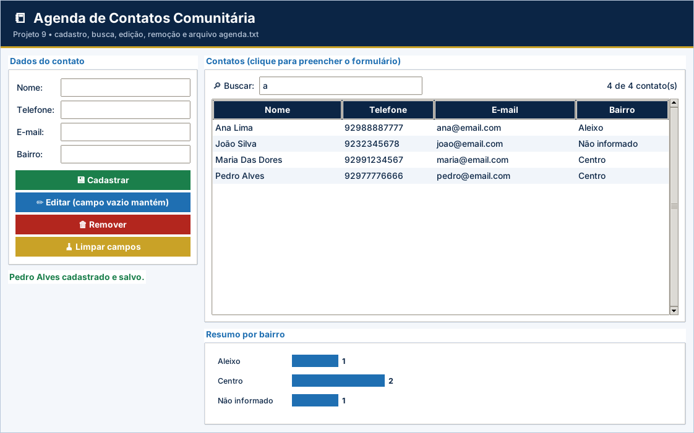

# Gabarito e correção – Projeto 9: Agenda de Contatos Comunitária

> Uso exclusivo do professor. A atribuição de notas é de sua competência.

## Como corrigir

1. Copie o `logica.py` do aluno para uma pasta com `app.py`, `testes_logica.py` e `ui_comum.py` deste projeto.
2. Rode `python ../corrigir.py <pasta>` (ou `python -m unittest -v testes_logica.py`).
3. Abra `python app.py` e confira o funcionamento na tela.

## Casos de teste

| Situação testada | Resultado esperado |
| --- | --- |
| Cadastrar “maria das dores”, “(92) 99123-4567”, “Maria@Email.com”, “centro” | Nome “Maria Das Dores”, telefone 92991234567, e-mail minúsculo, bairro “Centro” |
| Bairro vazio | “Não informado” |
| Nome vazio, com “;” ou repetido; telefone 123; e-mail sem @ | `ValueError` em cada caso |
| Listar | Ordem alfabética: Ana, João, Maria |
| Buscar “  MAR ” | Encontra “Maria Das Dores” |
| Editar com campos em branco | Mantém os valores atuais |
| Editar com telefone ou e-mail inválido | Mantém o anterior e devolve os avisos |
| Remover inexistente / salvar e reabrir | “Contato não encontrado.” / dados permanecem sem duplicar |

## Matriz de correção

| Critério | Pleno | Parcial | Insuficiente |
| --- | --- | --- | --- |
| Funcionamento | Os 9 testes passam e a tela mantém os dados ao reabrir. | Passam de 5 a 8 testes ou há falha em uma etapa da tela. | Menos de 5 testes passam ou a tela não funciona. |
| Arquivos | Salva tudo (`"w"`) e carrega com `strip()` e `split`. | Grava, mas duplica ou não carrega. | Sem arquivo. |
| Validações | Nome, telefone e e-mail conforme RN01–RN04. | Valida parte. | Sem validação. |
| Busca, edição e remoção | Funcionam e salvam após a alteração. | Esquece de salvar em uma operação. | Não funcionam. |
| Organização | Legível e comentado. | Pouco comentado. | Desorganizado. |

## Erros frequentes

- Editar o contato e esquecer de chamar `salvar_contatos`.
- Remover itens de uma lista dentro de um `for` sobre ela mesma.
- Comparar o trecho sem padronizar (“mar” não está em “Maria”).
- Não limpar o telefone antes de validar (“(92) 99123-4567” é rejeitado).
- Usar o modo `"a"` ao salvar tudo e duplicar os contatos.

## Orientações para os desafios extras

- **CSV:** cabeçalho `nome,telefone,email,bairro` e uma linha por contato.
- **Telefone repetido:** `any(c["telefone"] == telefone for c in contatos)` antes de acrescentar.
- **Backup:** `shutil.copyfile("agenda.txt", "agenda_backup.txt")` antes de `remover_contato`.

## Resultado dos testes do gabarito

```text
test_cadastro (testes_logica.TestAgenda.test_cadastro) ... ok
test_cadastro_invalido (testes_logica.TestAgenda.test_cadastro_invalido) ... ok
test_editar (testes_logica.TestAgenda.test_editar) ... ok
test_listar_e_buscar (testes_logica.TestAgenda.test_listar_e_buscar) ... ok
test_padronizacoes (testes_logica.TestAgenda.test_padronizacoes) ... ok
test_persistencia (testes_logica.TestAgenda.test_persistencia) ... ok
test_remover (testes_logica.TestAgenda.test_remover) ... ok
test_resumo (testes_logica.TestAgenda.test_resumo) ... ok
test_validacoes (testes_logica.TestAgenda.test_validacoes) ... ok

----------------------------------------------------------------------
Ran 9 tests in 0.002s

OK
```

## Tela do gabarito


