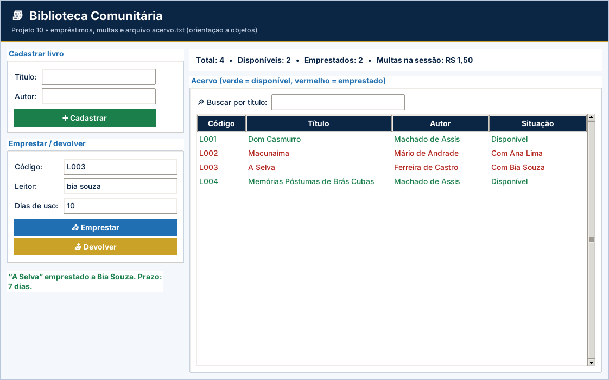

# Gabarito e correção – Projeto 10: Biblioteca Comunitária

> Uso exclusivo do professor. A atribuição de notas é de sua competência.

## Como corrigir

1. Copie o `logica.py` do aluno para uma pasta com `app.py`, `testes_logica.py` e `ui_comum.py` deste projeto.
2. Rode `python ../corrigir.py <pasta>` (ou `python -m unittest -v testes_logica.py`).
3. Abra `python app.py` e confira o funcionamento na tela.

## Casos de teste

| Situação testada | Resultado esperado |
| --- | --- |
| Primeira execução (sem arquivo) | Cria L001–L004 e salva `acervo.txt` |
| Cadastrar “  vidas secas ” de “graciliano ramos” | Código L005, textos padronizados |
| Cadastrar título ou autor vazio, ou com “;” | `ValueError` |
| Emprestar livro disponível / já emprestado / inexistente | Sucesso / falha citando o leitor / “Livro inexistente.” |
| Quarto empréstimo para o mesmo leitor | Falha: limite de 3 livros |
| Devolver com 7 e com 10 dias | Sem multa / R$ 1,50 |
| Devolver livro não emprestado ou com 0 dias | Falha com mensagem |
| Fechar e reabrir | Acervo e empréstimos carregados, sem duplicar livros |

## Matriz de correção

| Critério | Pleno | Parcial | Insuficiente |
| --- | --- | --- | --- |
| Funcionamento | Os 10 testes passam e a tela conclui empréstimo e devolução. | Passam de 5 a 9 testes ou há falha em uma etapa da tela. | Menos de 5 testes passam ou a tela não funciona. |
| Orientação a objetos | `Livro` e `Biblioteca` colaboram, com responsabilidades claras. | Classes com lógica misturada à tela. | Sem classes. |
| Regras de negócio | Prazo, multa, limite e mensagens corretos. | Erro em uma regra (ex.: multa no 7º dia). | Regras ausentes. |
| Persistência | Salva a cada operação e carrega ao iniciar. | Perde dados em alguma operação. | Não persiste. |
| Organização | Legível e comentado. | Pouco comentado. | Desorganizado. |

## Erros frequentes

- Multar no prazo (`dias >= PRAZO_DIAS` em vez de `dias > PRAZO_DIAS`).
- Esquecer de limpar o leitor ao devolver, deixando o livro “emprestado”.
- Gravar o leitor vazio como ausente (a linha fica com 3 campos e a leitura falha).
- Criar o acervo inicial a cada execução, duplicando os livros.
- Contar empréstimos com nomes não padronizados (“ana” ≠ “Ana”).

## Orientações para os desafios extras

- **Leitor:** `class Leitor: nome, livros` e `Biblioteca.leitores = {}`.
- **Reserva:** atributo `reservado_por` em `Livro`; ao devolver, retorne também o aviso.
- **Ranking:** atributo `vezes_emprestado` incrementado em `Livro.emprestar`, gravado como quinto campo.

## Resultado dos testes do gabarito

```text
test_acervo_inicial_criado_e_salvo (testes_logica.TestBiblioteca.test_acervo_inicial_criado_e_salvo) ... ok
test_adicionar (testes_logica.TestBiblioteca.test_adicionar) ... ok
test_buscas (testes_logica.TestBiblioteca.test_buscas) ... ok
test_devolver_e_multa (testes_logica.TestBiblioteca.test_devolver_e_multa) ... ok
test_devolver_falhas (testes_logica.TestBiblioteca.test_devolver_falhas) ... ok
test_emprestar_ok_e_falhas (testes_logica.TestBiblioteca.test_emprestar_ok_e_falhas) ... ok
test_limite_de_tres (testes_logica.TestBiblioteca.test_limite_de_tres) ... ok
test_persistencia_entre_execucoes (testes_logica.TestBiblioteca.test_persistencia_entre_execucoes) ... ok
test_relatorio (testes_logica.TestBiblioteca.test_relatorio) ... ok
test_livro (testes_logica.TestLivro.test_livro) ... ok

----------------------------------------------------------------------
Ran 10 tests in 0.006s

OK
```

## Tela do gabarito


