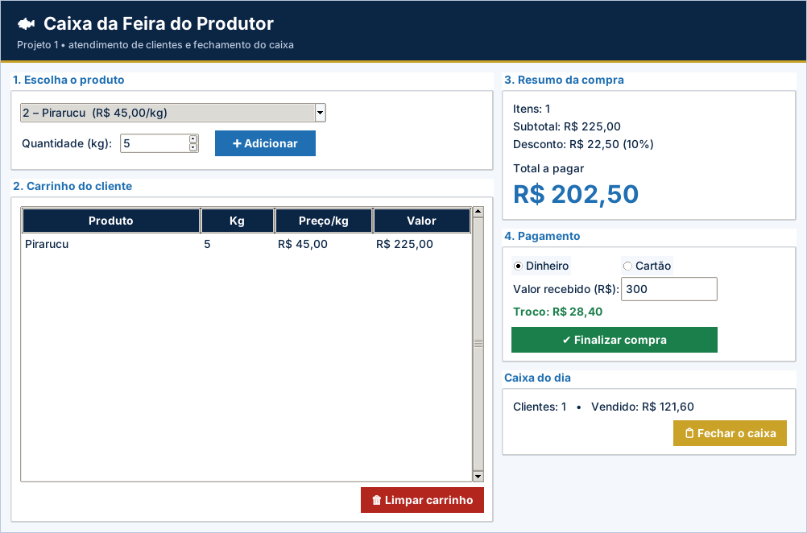

# Projeto 1 – Caixa da Feira do Produtor (versão gráfica)

| Ficha do projeto |  |
| --- | --- |
| **Tema** | Ponto de venda de uma feira regional |
| **Nível** | ★☆☆☆☆ |
| **Conteúdos** | Aulas 1 a 10: variáveis, tipos, `input()`, operadores, `if/elif/else`, `while`, `break`, `continue` |
| **Tempo sugerido** | 4 a 6 horas |
| **Organização** | individual ou dupla |
| **Interface** | Tela em `tkinter` (já pronta) + `logica.py` para você implementar |

> Este projeto usa as **mesmas regras** do projeto [1](../../projetos-integradores/projeto-01-caixa-da-feira/) em modo texto, agora com **janela gráfica** para rodar no VS Code. A tela já vem pronta; **você escreve a lógica** e os testes dizem se está certo.

## Cenário

Na feira do produtor de um bairro de Manaus, o caixa ainda é feito na calculadora e na caderneta. Os feirantes querem um **programa de caixa digital** que registre os produtos comprados por cada cliente, aplique descontos por volume, receba o pagamento e calcule o troco, e que ao fim do dia informe quanto foi vendido.

Os preços são **fictícios** e servem apenas para o exercício.

## Objetivos de aprendizagem

- Aplicar entrada e saída de dados com conversão de tipos.
- Tomar decisões com `if/elif/else` e condições compostas.
- Usar laços `while` para repetir atendimentos e validar entradas.
- Controlar o fluxo com `break` e `continue`.

## Dados de partida

| Código | Produto | Preço por kg (fictício) |
| --- | --- | --- |
| 1 | Tambaqui | R$ 28,00 |
| 2 | Pirarucu | R$ 45,00 |
| 3 | Tucunaré | R$ 32,00 |
| 4 | Farinha de mandioca | R$ 9,00 |

## Requisitos funcionais

| Código | O sistema deve... |
| --- | --- |
| RF01 | Exibir um **menu de produtos** (códigos 1 a 4) e a opção **0 – Finalizar compra**, repetindo o menu até o cliente finalizar. |
| RF02 | Para cada produto escolhido, pedir a **quantidade em kg** e mostrar a linha: produto, quantidade, preço por kg e valor. |
| RF03 | Acumular o **subtotal** da compra e a **quantidade de itens** registrados. |
| RF04 | Aplicar **desconto por volume** sobre o subtotal (regras RN02 e RN03). |
| RF05 | Mostrar o **resumo da compra**: itens, subtotal, desconto (com a porcentagem) e total a pagar. |
| RF06 | Perguntar a **forma de pagamento** (1 – Dinheiro, 2 – Cartão). No dinheiro, ler o valor recebido e **calcular o troco**. |
| RF07 | Perguntar **“Atender novo cliente? (s/n)”** e repetir o atendimento completo enquanto a resposta for “s”. |
| RF08 | Ao encerrar, mostrar o **fechamento do caixa**: clientes atendidos e total vendido no dia. |

> Na versão gráfica, os requisitos sobre **menu, `input()` e `print()`** são atendidos pela tela pronta (`app.py`). O seu foco são as **funções de lógica** listadas mais abaixo.

## Regras de negócio

| Código | Regra |
| --- | --- |
| RN01 | A quantidade deve ser **maior que zero**; caso contrário, avisar e perguntar de novo. |
| RN02 | Subtotal **a partir de R$ 100,00** e menor que R$ 200,00: **5%** de desconto. |
| RN03 | Subtotal **a partir de R$ 200,00**: **10%** de desconto. Abaixo de R$ 100,00: sem desconto. |
| RN04 | Opção de menu inexistente: avisar “Opção inválida!” e mostrar o menu novamente. |
| RN05 | Não é possível finalizar uma compra **sem nenhum item** registrado. |
| RN06 | No pagamento em dinheiro, o valor recebido não pode ser **menor que o total**: informar quanto falta e pedir de novo. |
| RN07 | A forma de pagamento só aceita 1 ou 2; repetir a pergunta se for outro valor. |

## A parte gráfica (já pronta)

Carrinho com tabela, resumo com desconto, pagamento com troco e fechamento do caixa.

Arquivos da pasta:

| Arquivo | Para que serve | Você altera? |
| --- | --- | --- |
| `app.py` | Monta a janela (botões, tabelas, gráficos) e chama a lógica | Não (só nos desafios extras) |
| `logica.py` | **Regras de negócio** do projeto | **Sim – é o seu trabalho** |
| `testes_logica.py` | Testes automáticos da lógica | Não |
| `ui_comum.py` | Cores, botões e utilitários de tela | Não |

## O que você vai implementar

Abra `logica.py`. Cada função abaixo começa com `raise NotImplementedError(...)`: apague essa linha e escreva a solução. Quando uma regra for violada, use `raise ValueError("mensagem")`: a tela mostra a mensagem em uma janela de aviso.

| Função | O que deve fazer |
| --- | --- |
| `validar_quantidade(qtd)` | RN01: a quantidade em kg deve ser maior que zero. Retorna a quantidade. |
| `valor_item(preco, qtd)` | RF02: valor da linha = preço × quantidade, arredondado em 2 casas. |
| `percentual_desconto(subtotal)` | RN02 e RN03: 0 (abaixo de 100), 5 (de 100 a menos de 200) ou 10 (200 ou mais). |
| `calcular_resumo(itens)` | RF03–RF05: recebe a lista de itens [(produto, qtd, preco), ...]. |
| `calcular_troco(total, recebido)` | RF06 e RN06: troco do pagamento em dinheiro. |
| `fechamento(vendas)` | RF08: recebe a lista de totais pagos [12.5, 80.0, ...]. |

## Como executar no VS Code

1. Abra **a pasta deste projeto** no VS Code (*File → Open Folder*).
2. Abra o terminal (`Ctrl + '`) e confira o `tkinter`: `python -m tkinter` abre uma janelinha de teste.
3. Rode os testes e veja o que falta: `python -m unittest -v testes_logica.py`
4. Implemente uma função por vez e repita o passo 3 até aparecer **OK**.
5. Abra a tela: `python app.py` e use o programa de verdade.

> No Linux, se faltar o `tkinter`: `sudo apt install python3-tk`. No Windows e no macOS ele já vem com o Python do python.org.

## O que entregar

- A pasta do projeto com `logica.py` completo (e `app.py`, se você fez desafios extras).
- Uma **captura de tela** do programa em uso.
- O resultado do comando `python -m unittest -v testes_logica.py`.
- Para projetos com arquivo (4, 5, 9 e 10): mostre que os dados continuam ao fechar e abrir a tela de novo.

## Critérios de avaliação

Sua entrega é avaliada em três níveis (**Pleno**, **Parcial** ou **Insuficiente**) nos critérios abaixo. O que significa o nível **Pleno**:

- **Funcionamento:** Os 10 testes passam e a tela conclui uma compra completa.
- **Regras de desconto:** Faixas e limites (100 e 200) corretos.
- **Validações:** Quantidade, carrinho vazio e troco tratados com `ValueError`.
- **Uso dos conteúdos:** Funções, decisões, `sum`, arredondamento e listas bem aplicados.
- **Organização:** Legível, comentado, nomes claros.

## Desafios extras (opcionais)

- **Nota do cliente:** botão que grava `nota_cliente.txt` com os itens, o desconto e o total.
- **Gráfico de vendas:** desenhe no `Canvas` as barras de kg vendidos por produto no dia.
- **Atalho:** pressionar `Enter` no campo de quantidade adiciona o item.
