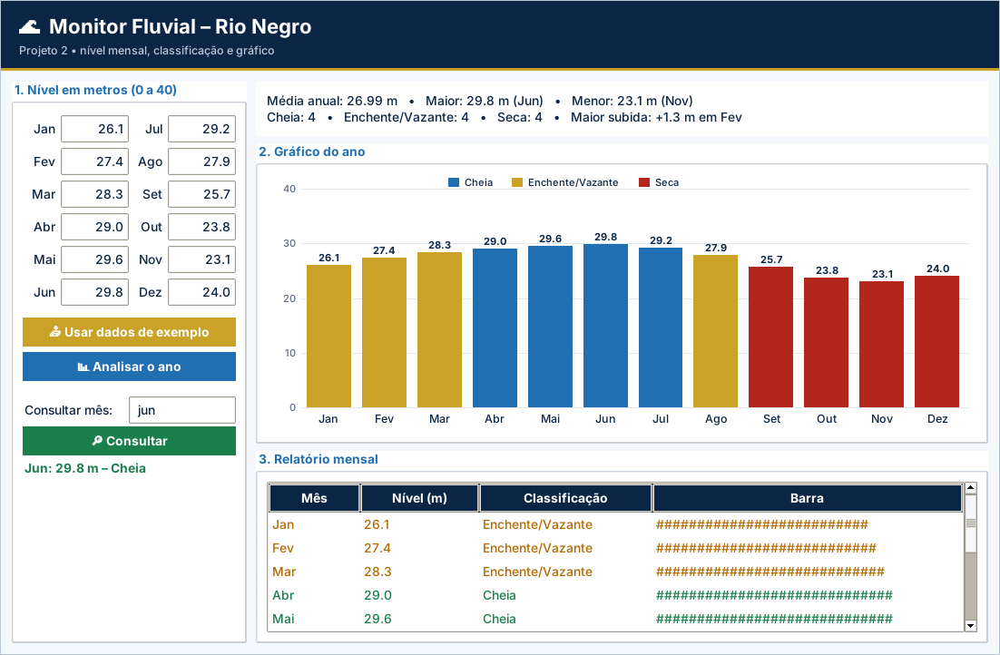

# Projeto 2 – Monitor Fluvial: Nível do Rio Negro (versão gráfica)

| Ficha do projeto |  |
| --- | --- |
| **Tema** | Análise de medições do nível de um rio |
| **Nível** | ★★☆☆☆ |
| **Conteúdos** | Aulas 1 a 14: listas, dicionários, strings, `for`/`range`, decisões, métodos de listas e funções internas |
| **Tempo sugerido** | 6 a 8 horas |
| **Organização** | individual ou dupla |
| **Interface** | Tela em `tkinter` (já pronta) + `logica.py` para você implementar |

> Este projeto usa as **mesmas regras** do projeto [2](../../projetos-integradores/projeto-02-monitor-fluvial/) em modo texto, agora com **janela gráfica** para rodar no VS Code. A tela já vem pronta; **você escreve a lógica** e os testes dizem se está certo.

## Cenário

Pesquisadores e comunidades ribeirinhas acompanham o **nível do Rio Negro** em Manaus mês a mês, pois ele determina a navegação, a pesca e a vida às margens. Você vai criar um **monitor fluvial**: o programa recebe as 12 medições do ano, analisa os dados e permite consultar qualquer mês.

Use **dados fictícios** na hora de testar (sugestão: 26,1 / 27,4 / 28,3 / 29,0 / 29,6 / 29,8 / 29,2 / 27,9 / 25,7 / 23,8 / 23,1 / 24,0 metros).

## Objetivos de aprendizagem

- Armazenar e processar dados em **listas** paralelas.
- Percorrer listas com `for` e `range(len(...))`.
- Usar **dicionários** como contadores.
- Manipular **strings** para padronizar buscas.
- Usar `sum`, `max`, `min`, `len` e `index`.

## Requisitos funcionais

| Código | O sistema deve... |
| --- | --- |
| RF01 | Criar a lista `meses` (Jan a Dez) e ler, com `for`, o **nível em metros** de cada mês, guardando-os na lista `niveis`. |
| RF02 | Calcular e mostrar a **média anual**, o **maior** e o **menor** nível, informando **em qual mês** ocorreram. |
| RF03 | Classificar cada mês (**Cheia**, **Enchente/Vazante** ou **Seca**) e mostrar um **relatório** com mês, nível, classificação e uma **barra de caracteres** proporcional ao nível. |
| RF04 | Usar um **dicionário** para contar quantos meses há em cada classificação. |
| RF05 | Descobrir o **mês de maior subida** do nível em relação ao mês anterior e quanto subiu. |
| RF06 | **Consulta por mês**: o usuário digita o nome do mês (com qualquer combinação de maiúsculas, minúsculas e espaços) e o programa mostra nível e classificação; “fim” encerra. |

> Na versão gráfica, os requisitos sobre **menu, `input()` e `print()`** são atendidos pela tela pronta (`app.py`). O seu foco são as **funções de lógica** listadas mais abaixo.

## Regras de negócio

| Código | Regra |
| --- | --- |
| RN01 | Níveis válidos: de **0 a 40 metros**. Valor fora da faixa: avisar e pedir de novo. |
| RN02 | Nível **a partir de 29 m**: “Cheia”. **De 26 m até menos de 29 m**: “Enchente/Vazante”. **Abaixo de 26 m**: “Seca”. |
| RN03 | A barra do relatório tem **um caractere `#` para cada metro inteiro** (use `int(nivel)`). |
| RN04 | Na consulta, mês inexistente: mostrar “Mês não encontrado.” |
| RN05 | A maior subida considera apenas variações **positivas** (de um mês para o seguinte). |

## A parte gráfica (já pronta)

Doze campos de nível, gráfico de barras colorido por classificação, estatísticas e consulta por mês.

Arquivos da pasta:

| Arquivo | Para que serve | Você altera? |
| --- | --- | --- |
| `app.py` | Monta a janela (botões, tabelas, gráficos) e chama a lógica | Não (só nos desafios extras) |
| `logica.py` | **Regras de negócio** do projeto | **Sim – é o seu trabalho** |
| `testes_logica.py` | Testes automáticos da lógica | Não |
| `ui_comum.py` | Cores, botões e utilitários de tela | Não |

## O que você vai implementar

Abra `logica.py`. Cada função abaixo começa com `raise NotImplementedError(...)`: apague essa linha e escreva a solução. Quando uma regra for violada, use `raise ValueError("mensagem")`: a tela mostra a mensagem em uma janela de aviso.

| Função | O que deve fazer |
| --- | --- |
| `validar_nivel(nivel)` | RN01: o nível deve estar entre 0 e 40 metros (inclusive). Retorna o nível. |
| `classificar(nivel)` | RN02: 'Cheia' (>= 29), 'Enchente/Vazante' (>= 26 e < 29) ou 'Seca' (< 26). |
| `barra(nivel)` | RN03: um '#' para cada metro inteiro (use int(nivel)). |
| `estatisticas(niveis)` | RF02: retorna um dicionário com 'media', 'maior', 'mes_maior', 'menor' e 'mes_menor'. |
| `contar_classificacoes(niveis)` | RF04: dicionário contador {'Cheia': n, 'Enchente/Vazante': n, 'Seca': n}. |
| `maior_subida(niveis)` | RF05 e RN05: retorna (valor, mes) da maior subida POSITIVA em relação ao mês anterior. |
| `consultar_mes(texto, niveis)` | RF06 e RN04: busca o mês ignorando maiúsculas/minúsculas e espaços. |

## Como executar no VS Code

1. Abra **a pasta deste projeto** no VS Code (*File → Open Folder*).
2. Abra o terminal (`Ctrl + '`) e confira o `tkinter`: `python -m tkinter` abre uma janelinha de teste.
3. Rode os testes e veja o que falta: `python -m unittest -v testes_logica.py`
4. Implemente uma função por vez e repita o passo 3 até aparecer **OK**.
5. Abra a tela: `python app.py` e use o programa de verdade.

> No Linux, se faltar o `tkinter`: `sudo apt install python3-tk`. No Windows e no macOS ele já vem com o Python do python.org.

## O que entregar

- A pasta do projeto com `logica.py` completo (e `app.py`, se você fez desafios extras).
- Uma **captura de tela** do programa em uso.
- O resultado do comando `python -m unittest -v testes_logica.py`.
- Para projetos com arquivo (4, 5, 9 e 10): mostre que os dados continuam ao fechar e abrir a tela de novo.

## Critérios de avaliação

Sua entrega é avaliada em três níveis (**Pleno**, **Parcial** ou **Insuficiente**) nos critérios abaixo. O que significa o nível **Pleno**:

- **Funcionamento:** Os 7 testes passam e o gráfico reflete os dados.
- **Estruturas de dados:** Listas paralelas e dicionário contador corretos.
- **Regras de negócio:** Faixas, limites e maior subida corretos.
- **Strings:** Consulta padronizada com `strip()` e `title()`.
- **Organização:** Legível e comentado.

## Desafios extras (opcionais)

- **Gráfico de linha:** troque as barras por uma linha ligando os pontos (`create_line`).
- **Meses críticos:** pinte de vermelho forte os meses abaixo de 24 m e liste-os na tela.
- **Segundo ano:** leia uma segunda série de níveis e desenhe as duas no mesmo gráfico.
