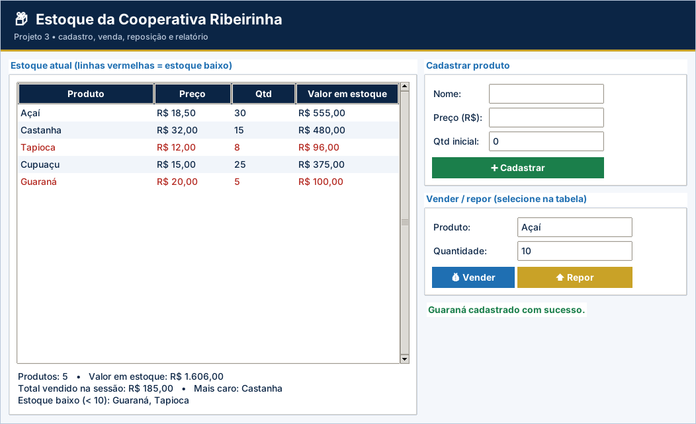

# Projeto 3 – Estoque da Cooperativa Ribeirinha (versão gráfica)

| Ficha do projeto |  |
| --- | --- |
| **Tema** | Controle de estoque e vendas com funções |
| **Nível** | ★★★☆☆ |
| **Conteúdos** | Aulas 1 a 16: dicionários aninhados, funções com parâmetros e retorno, menu com `while`, validações, strings |
| **Tempo sugerido** | 8 a 10 horas |
| **Organização** | dupla |
| **Interface** | Tela em `tkinter` (já pronta) + `logica.py` para você implementar |

> Este projeto usa as **mesmas regras** do projeto [3](../../projetos-integradores/projeto-03-estoque-da-cooperativa/) em modo texto, agora com **janela gráfica** para rodar no VS Code. A tela já vem pronta; **você escreve a lógica** e os testes dizem se está certo.

## Cenário

Uma **cooperativa de produtores ribeirinhos** vende açaí, castanha, tapioca e cupuaçu. O controle é feito em caderno e frequentemente falta produto ou há venda além do estoque. Sua missão é construir o **sistema de estoque**, organizado em **funções**, para cadastrar produtos, registrar vendas e reposições e emitir um relatório.

Todos os preços e quantidades são **fictícios**.

## Objetivos de aprendizagem

- Modelar dados com **dicionários aninhados**.
- Dividir o programa em **funções** com parâmetros e retorno.
- Validar entradas e regras de negócio.
- Construir um menu completo e um relatório gerencial.

## Dados de partida

| Produto inicial | Preço unitário | Quantidade |
| --- | --- | --- |
| Açaí | R$ 18,50 | 40 |
| Castanha | R$ 32,00 | 15 |
| Tapioca | R$ 12,00 | 8 |
| Cupuaçu | R$ 15,00 | 25 |

## Requisitos funcionais

| Código | O sistema deve... |
| --- | --- |
| RF01 | Iniciar o programa com o **estoque inicial** da tabela, em um dicionário `{nome: {"preco": ..., "qtd": ...}}`. |
| RF02 | **Menu** com: 1 – Listar estoque, 2 – Cadastrar produto, 3 – Registrar venda, 4 – Repor estoque, 5 – Relatório, 0 – Sair. |
| RF03 | **Listar** todos os produtos com preço e quantidade. |
| RF04 | **Cadastrar** produto novo (nome, preço, quantidade inicial). |
| RF05 | **Vender**: informar produto e quantidade, baixar o estoque e **devolver o valor da venda**, acumulando o total vendido na sessão. |
| RF06 | **Repor**: somar uma quantidade ao estoque de um produto existente. |
| RF07 | **Relatório**: número de produtos, valor total em estoque, total vendido, produto mais caro e lista de produtos com **estoque baixo**. |
| RF08 | O programa deve ser organizado em **funções** (no mínimo: `exibir_menu`, `listar_estoque`, `cadastrar_produto`, `vender`, `repor`, `valor_total` e `relatorio`). |

> Na versão gráfica, os requisitos sobre **menu, `input()` e `print()`** são atendidos pela tela pronta (`app.py`). O seu foco são as **funções de lógica** listadas mais abaixo.

## Regras de negócio

| Código | Regra |
| --- | --- |
| RN01 | Nomes de produtos são padronizados com `strip()` e `title()` (“AÇAÍ” e “  açaí” são o mesmo produto). |
| RN02 | Não cadastrar produto **repetido** nem com nome vazio. |
| RN03 | Preço deve ser **maior que zero**; quantidade inicial **não pode ser negativa**. |
| RN04 | Não vender produto inexistente, quantidade menor ou igual a zero ou **quantidade maior que o estoque**. |
| RN05 | Reposição exige produto existente e quantidade **maior que zero**. |
| RN06 | **Estoque baixo**: menos de 10 unidades. |

## A parte gráfica (já pronta)

Tabela de estoque (linhas vermelhas quando baixo), formulários de cadastro, venda e reposição e relatório.

Arquivos da pasta:

| Arquivo | Para que serve | Você altera? |
| --- | --- | --- |
| `app.py` | Monta a janela (botões, tabelas, gráficos) e chama a lógica | Não (só nos desafios extras) |
| `logica.py` | **Regras de negócio** do projeto | **Sim – é o seu trabalho** |
| `testes_logica.py` | Testes automáticos da lógica | Não |
| `ui_comum.py` | Cores, botões e utilitários de tela | Não |

## O que você vai implementar

Abra `logica.py`. Cada função abaixo começa com `raise NotImplementedError(...)`: apague essa linha e escreva a solução. Quando uma regra for violada, use `raise ValueError("mensagem")`: a tela mostra a mensagem em uma janela de aviso.

| Função | O que deve fazer |
| --- | --- |
| `padronizar_nome(nome)` | RN01: strip() e title()  ('  AÇAÍ ' -> 'Açaí'). |
| `cadastrar_produto(estoque, nome, preco, qtd)` | RF04, RN02 e RN03: cadastra o produto e retorna o nome padronizado. |
| `vender(estoque, nome, qtd)` | RF05 e RN04: baixa o estoque e devolve o valor da venda (preço × qtd, 2 casas). |
| `repor(estoque, nome, qtd)` | RF06 e RN05: soma qtd ao estoque. Erros: produto inexistente ou qtd <= 0. |
| `valor_total(estoque)` | Soma de preço × quantidade de todos os produtos (2 casas). |
| `estoque_baixo(estoque)` | RN06: lista (em ordem alfabética) dos nomes com quantidade menor que MINIMO. |
| `relatorio(estoque, total_vendido)` | RF07: dicionário com 'produtos', 'valor_estoque', 'total_vendido', 'mais_caro' e 'baixo'. |

## Como executar no VS Code

1. Abra **a pasta deste projeto** no VS Code (*File → Open Folder*).
2. Abra o terminal (`Ctrl + '`) e confira o `tkinter`: `python -m tkinter` abre uma janelinha de teste.
3. Rode os testes e veja o que falta: `python -m unittest -v testes_logica.py`
4. Implemente uma função por vez e repita o passo 3 até aparecer **OK**.
5. Abra a tela: `python app.py` e use o programa de verdade.

> No Linux, se faltar o `tkinter`: `sudo apt install python3-tk`. No Windows e no macOS ele já vem com o Python do python.org.

## O que entregar

- A pasta do projeto com `logica.py` completo (e `app.py`, se você fez desafios extras).
- Uma **captura de tela** do programa em uso.
- O resultado do comando `python -m unittest -v testes_logica.py`.
- Para projetos com arquivo (4, 5, 9 e 10): mostre que os dados continuam ao fechar e abrir a tela de novo.

## Critérios de avaliação

Sua entrega é avaliada em três níveis (**Pleno**, **Parcial** ou **Insuficiente**) nos critérios abaixo. O que significa o nível **Pleno**:

- **Funcionamento:** Os 9 testes passam e a tela atualiza após cada operação.
- **Dicionários aninhados:** `estoque[nome]["qtd"]` e `["preco"]` usados corretamente.
- **Funções:** Todas as funções com parâmetros e retorno corretos.
- **Validações:** Todas as regras RN01–RN06 verificadas.
- **Organização:** Legível e comentado.

## Desafios extras (opcionais)

- **Exportar CSV:** botão que grava `estoque.csv` com cabeçalho.
- **Ordenar:** clicar no cabeçalho da coluna ordena a tabela.
- **Coluna Status:** mostre “OK” ou “BAIXO” em cada linha.
