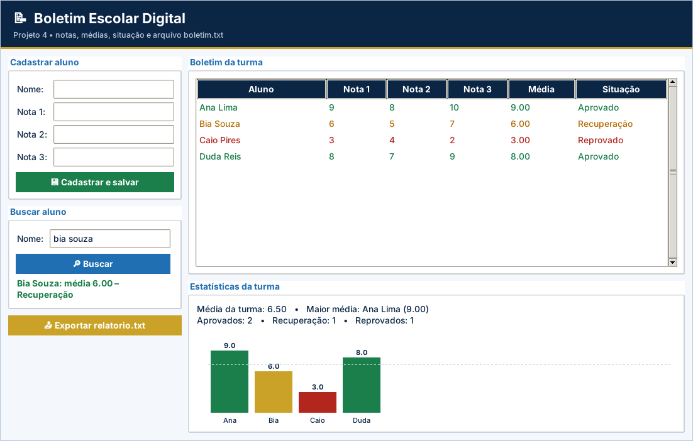

# Projeto 4 – Boletim Escolar Digital (versão gráfica)

| Ficha do projeto |  |
| --- | --- |
| **Tema** | Cadastro de alunos e notas com persistência em arquivo |
| **Nível** | ★★★★☆ |
| **Conteúdos** | Aulas 1 a 17: listas de dicionários, funções, strings, arquivos `.txt` (leitura e escrita), laços e decisões |
| **Tempo sugerido** | 8 a 12 horas |
| **Organização** | dupla |
| **Interface** | Tela em `tkinter` (já pronta) + `logica.py` para você implementar |

> Este projeto usa as **mesmas regras** do projeto [4](../../projetos-integradores/projeto-04-boletim-escolar-digital/) em modo texto, agora com **janela gráfica** para rodar no VS Code. A tela já vem pronta; **você escreve a lógica** e os testes dizem se está certo.

## Cenário

Uma escola quer abandonar o boletim em papel. Você foi contratado(a) para criar o **Boletim Escolar Digital**: o professor cadastra alunos e suas três notas, o sistema calcula a média e a situação, e **guarda tudo em arquivo**, para que os dados não se percam ao fechar o programa. Também deve gerar um **relatório** em arquivo de texto.

## Objetivos de aprendizagem

- Combinar **listas e dicionários** (lista de alunos; notas em lista).
- Persistir dados com **leitura e escrita de arquivos .txt**.
- Organizar o sistema em **funções** reutilizáveis.
- Calcular estatísticas e gerar relatório.

## Requisitos funcionais

| Código | O sistema deve... |
| --- | --- |
| RF01 | Ao iniciar, **carregar** os alunos de `boletim.txt` (se o arquivo ainda não existir, começar com a lista vazia). |
| RF02 | **Menu**: 1 – Cadastrar aluno, 2 – Listar boletim, 3 – Buscar aluno, 4 – Estatísticas da turma, 5 – Exportar relatório, 0 – Sair. |
| RF03 | **Cadastrar** aluno com nome e **3 notas** (0 a 10) e **salvar** no arquivo imediatamente. |
| RF04 | **Listar** o boletim: nome, as três notas, **média** e **situação** de cada aluno. |
| RF05 | **Buscar** um aluno pelo nome (sem diferenciar maiúsculas/minúsculas) e mostrar seu boletim. |
| RF06 | **Estatísticas**: média da turma, aluno com a maior média e quantidade de alunos em cada situação. |
| RF07 | **Exportar** um relatório para `relatorio.txt` com uma linha `nome;média;situação` por aluno. |

> Na versão gráfica, os requisitos sobre **menu, `input()` e `print()`** são atendidos pela tela pronta (`app.py`). O seu foco são as **funções de lógica** listadas mais abaixo.

## Regras de negócio

| Código | Regra |
| --- | --- |
| RN01 | Notas válidas: de **0 a 10**. Fora da faixa, avisar e pedir de novo. |
| RN02 | **Média** = soma das três notas dividida por 3. **≥ 7**: Aprovado; **≥ 5 e < 7**: Recuperação; **< 5**: Reprovado. |
| RN03 | Não cadastrar aluno com **nome repetido**, vazio ou contendo `;` (o ponto e vírgula é o separador do arquivo). |
| RN04 | Nomes são padronizados com `strip()` e `title()`. |
| RN05 | Com a lista vazia, listar e estatísticas devem avisar “Nenhum aluno cadastrado.” sem gerar erro. |
| RN06 | Os dados devem **permanecer** ao fechar e reabrir o programa. |

## A parte gráfica (já pronta)

Cadastro com salvamento em arquivo, boletim colorido por situação, busca, estatísticas e gráfico de médias.

Arquivos da pasta:

| Arquivo | Para que serve | Você altera? |
| --- | --- | --- |
| `app.py` | Monta a janela (botões, tabelas, gráficos) e chama a lógica | Não (só nos desafios extras) |
| `logica.py` | **Regras de negócio** do projeto | **Sim – é o seu trabalho** |
| `testes_logica.py` | Testes automáticos da lógica | Não |
| `ui_comum.py` | Cores, botões e utilitários de tela | Não |

## O que você vai implementar

Abra `logica.py`. Cada função abaixo começa com `raise NotImplementedError(...)`: apague essa linha e escreva a solução. Quando uma regra for violada, use `raise ValueError("mensagem")`: a tela mostra a mensagem em uma janela de aviso.

| Função | O que deve fazer |
| --- | --- |
| `calcular_media(notas)` | RN02: média = soma das notas / quantidade de notas. |
| `situacao(media)` | RN02: 'Aprovado' (>= 7), 'Recuperação' (>= 5 e < 7) ou 'Reprovado' (< 5). |
| `validar_nota(nota)` | RN01: a nota deve estar entre 0 e 10 (inclusive). Retorna a nota. |
| `cadastrar_aluno(alunos, nome, notas)` | RF03, RN01, RN03 e RN04: valida e acrescenta o aluno à lista. Retorna o aluno. |
| `buscar_aluno(alunos, nome)` | RF05: retorna o aluno com esse nome (sem diferenciar maiúsculas) ou None. |
| `estatisticas(alunos)` | RF06 e RN05: retorna {'media_turma', 'melhor_nome', 'melhor_media', 'situacoes'}. |
| `salvar_alunos(alunos, arquivo)` | RF03 e RN06: grava uma linha  nome;n1;n2;n3  por aluno (modo 'w', encoding utf-8). |
| `carregar_alunos(arquivo)` | RF01: lê o arquivo e retorna a lista de alunos. Arquivo inexistente -> lista vazia. |
| `exportar_relatorio(alunos, arquivo)` | RF07: grava  nome;média;situação  por aluno (média com 2 casas). Retorna nº de linhas. |

## Como executar no VS Code

1. Abra **a pasta deste projeto** no VS Code (*File → Open Folder*).
2. Abra o terminal (`Ctrl + '`) e confira o `tkinter`: `python -m tkinter` abre uma janelinha de teste.
3. Rode os testes e veja o que falta: `python -m unittest -v testes_logica.py`
4. Implemente uma função por vez e repita o passo 3 até aparecer **OK**.
5. Abra a tela: `python app.py` e use o programa de verdade.

> No Linux, se faltar o `tkinter`: `sudo apt install python3-tk`. No Windows e no macOS ele já vem com o Python do python.org.

## O que entregar

- A pasta do projeto com `logica.py` completo (e `app.py`, se você fez desafios extras).
- Uma **captura de tela** do programa em uso.
- O resultado do comando `python -m unittest -v testes_logica.py`.
- Para projetos com arquivo (4, 5, 9 e 10): mostre que os dados continuam ao fechar e abrir a tela de novo.

## Critérios de avaliação

Sua entrega é avaliada em três níveis (**Pleno**, **Parcial** ou **Insuficiente**) nos critérios abaixo. O que significa o nível **Pleno**:

- **Funcionamento:** Os 7 testes passam e os dados permanecem ao reabrir a tela.
- **Arquivos:** Leitura e escrita corretas, `strip()` e `split(";")`.
- **Estruturas de dados:** Lista de dicionários bem manipulada.
- **Regras de negócio:** Faixas, nome e notas corretas.
- **Organização:** Legível e comentado.

## Desafios extras (opcionais)

- **Ordenar por média:** botão que mostra o ranking da turma.
- **Filtro:** `Combobox` para ver só Aprovados, Recuperação ou Reprovados.
- **Gráfico de pizza:** desenhe as três situações com `create_arc`.
