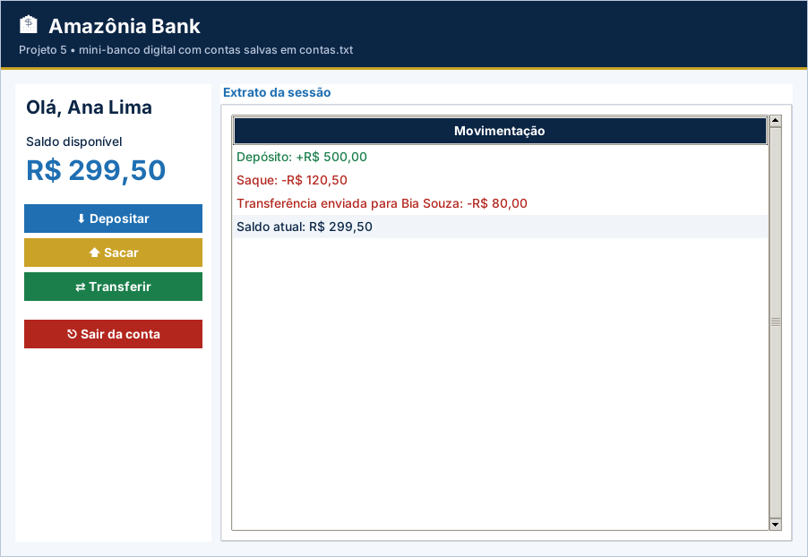

# Projeto 5 – Amazônia Bank: Mini-Banco Digital (versão gráfica)

| Ficha do projeto |  |
| --- | --- |
| **Tema** | Sistema bancário com POO, arquivos e login |
| **Nível** | ★★★★★ |
| **Conteúdos** | Aulas 1 a 19: classes e objetos, métodos, atributos, dicionário de objetos, arquivos, funções, menus aninhados e validações |
| **Tempo sugerido** | 12 a 16 horas |
| **Organização** | dupla |
| **Interface** | Tela em `tkinter` (já pronta) + `logica.py` para você implementar |

> Este projeto usa as **mesmas regras** do projeto [5](../../projetos-integradores/projeto-05-amazonia-bank/) em modo texto, agora com **janela gráfica** para rodar no VS Code. A tela já vem pronta; **você escreve a lógica** e os testes dizem se está certo.

## Cenário

Uma cooperativa de crédito de Manaus quer lançar o **Amazônia Bank**, um mini-banco digital de terminal. Cada cliente cria uma conta com **senha de 4 dígitos**, faz login e realiza **depósitos, saques, transferências** e consulta **saldo e extrato**. Os dados das contas devem **permanecer salvos em arquivo**.

Este é o **projeto final do curso**: ele integra todos os conteúdos, incluindo a **Programação Orientada a Objetos**. Os valores são **fictícios**.

## Objetivos de aprendizagem

- Modelar o domínio com **classes**, atributos e métodos.
- Manter um **dicionário de objetos** (`titular → Conta`).
- Persistir e recarregar os dados com **arquivos**.
- Construir **menus aninhados** com autenticação.
- Aplicar validações e regras de negócio bancárias.

## Requisitos funcionais

| Código | O sistema deve... |
| --- | --- |
| RF01 | Criar a classe **`Conta`** com os atributos `titular`, `senha`, `saldo` (inicial 0) e `historico` (lista de movimentações). |
| RF02 | Implementar os métodos **`depositar(valor)`**, **`sacar(valor)`** e **`transferir(destino, valor)`**, que devolvem `True` (operação realizada) ou `False`, e atualizam o `historico`. |
| RF03 | Implementar **`extrato()`**, que mostra as movimentações da sessão e o saldo atual, e **`autenticar(senha)`**. |
| RF04 | **Menu principal**: 1 – Criar conta, 2 – Entrar, 0 – Sair. |
| RF05 | **Menu da conta** (após o login): 1 – Saldo, 2 – Depositar, 3 – Sacar, 4 – Transferir, 5 – Extrato, 0 – Sair da conta. |
| RF06 | **Persistir** as contas em `contas.txt` (`titular;senha;saldo`) após cada criação e cada operação financeira, e **carregá-las** ao iniciar. |
| RF07 | Organizar o código com a classe `Conta` e **funções** para carregar, salvar, criar conta e menus. |

> Na versão gráfica, os requisitos sobre **menu, `input()` e `print()`** são atendidos pela tela pronta (`app.py`). O seu foco são as **funções de lógica** listadas mais abaixo.

## Regras de negócio

| Código | Regra |
| --- | --- |
| RN01 | Titular padronizado com `strip()` e `title()`; **não pode ser vazio, conter `;` nem repetir** um titular existente. |
| RN02 | A senha deve ter **exatamente 4 dígitos numéricos**. |
| RN03 | Login só é aceito com **titular existente e senha correta**; caso contrário, “Titular ou senha inválidos.” |
| RN04 | Depósito, saque e transferência exigem **valor maior que zero**. |
| RN05 | Não é permitido **sacar ou transferir mais do que o saldo**. |
| RN06 | A transferência exige **conta de destino existente** e **diferente da conta de origem**; registra movimentação nas duas contas. |
| RN07 | O saldo deve ser exibido sempre com **duas casas decimais**. |

## A parte gráfica (já pronta)

Login e abertura de conta, painel com saldo, depósito, saque, transferência e extrato.

Arquivos da pasta:

| Arquivo | Para que serve | Você altera? |
| --- | --- | --- |
| `app.py` | Monta a janela (botões, tabelas, gráficos) e chama a lógica | Não (só nos desafios extras) |
| `logica.py` | **Regras de negócio** do projeto | **Sim – é o seu trabalho** |
| `testes_logica.py` | Testes automáticos da lógica | Não |
| `ui_comum.py` | Cores, botões e utilitários de tela | Não |

## O que você vai implementar

Abra `logica.py`. Cada função abaixo começa com `raise NotImplementedError(...)`: apague essa linha e escreva a solução. Quando uma regra for violada, use `raise ValueError("mensagem")`: a tela mostra a mensagem em uma janela de aviso.

| Função | O que deve fazer |
| --- | --- |
| `Conta.autenticar(senha)` | RF03: True se a senha estiver correta. |
| `Conta.depositar(valor)` | RF02, RN04: valor > 0. Soma ao saldo e registra 'Depósito: +R$ ...' no histórico. |
| `Conta.sacar(valor)` | RF02, RN04 e RN05: valor > 0 e não maior que o saldo. Registra 'Saque: -R$ ...'. |
| `Conta.transferir(destino, valor)` | RF02 e RN06: transfere para outra Conta. Registra nas DUAS contas. |
| `Conta.extrato()` | RF03: lista de textos — movimentações da sessão e, por último, 'Saldo atual: R$ ...'. |
| `criar_conta(contas, titular, senha)` | RF04, RN01 e RN02: cria e retorna a Conta (guarda em contas[titular]). |
| `entrar(contas, titular, senha)` | RN03: retorna a Conta se titular existir e a senha estiver correta. |
| `salvar_contas(contas, arquivo)` | RF06: grava  titular;senha;saldo  (saldo com 2 casas) — modo 'w', utf-8. |
| `carregar_contas(arquivo)` | RF06: lê o arquivo e retorna {titular: Conta}. Arquivo inexistente -> {}. |

## Como executar no VS Code

1. Abra **a pasta deste projeto** no VS Code (*File → Open Folder*).
2. Abra o terminal (`Ctrl + '`) e confira o `tkinter`: `python -m tkinter` abre uma janelinha de teste.
3. Rode os testes e veja o que falta: `python -m unittest -v testes_logica.py`
4. Implemente uma função por vez e repita o passo 3 até aparecer **OK**.
5. Abra a tela: `python app.py` e use o programa de verdade.

> No Linux, se faltar o `tkinter`: `sudo apt install python3-tk`. No Windows e no macOS ele já vem com o Python do python.org.

## O que entregar

- A pasta do projeto com `logica.py` completo (e `app.py`, se você fez desafios extras).
- Uma **captura de tela** do programa em uso.
- O resultado do comando `python -m unittest -v testes_logica.py`.
- Para projetos com arquivo (4, 5, 9 e 10): mostre que os dados continuam ao fechar e abrir a tela de novo.

## Critérios de avaliação

Sua entrega é avaliada em três níveis (**Pleno**, **Parcial** ou **Insuficiente**) nos critérios abaixo. O que significa o nível **Pleno**:

- **Funcionamento:** Os 9 testes passam e o fluxo login → operação → extrato funciona.
- **Orientação a objetos:** Classe `Conta` com atributos e métodos coerentes.
- **Regras de negócio:** RN01–RN07 todas atendidas.
- **Persistência:** Salva após cada operação e carrega ao abrir.
- **Organização:** Legível e comentado.

## Desafios extras (opcionais)

- **Limite de tentativas:** bloqueie o login por 30 segundos após 3 senhas erradas.
- **Alterar senha:** botão na tela da conta (exige a senha atual).
- **Extrato em arquivo:** botão que grava `extrato_<titular>.txt`.
