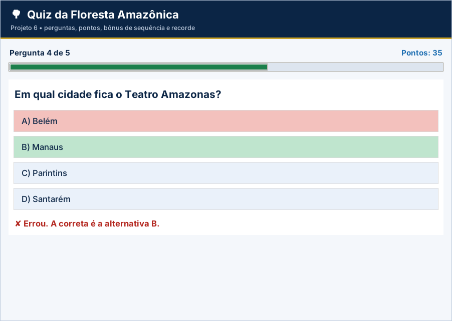

# Projeto 6 – Quiz da Floresta Amazônica (versão gráfica)

| **Ficha do projeto** |  |
| --- | --- |
| **Tema** | Jogo de perguntas e respostas com pontuação |
| **Nível** | ★☆☆☆☆ |
| **Tempo sugerido** | 4 a 6 horas |
| **Forma de trabalho** | individual ou dupla |
| **Aulas relacionadas** | Aulas 1 a 10 |
| **Conteúdos** | variáveis, `input()`, operadores, `if/elif/else`, `while`, `for/range`, contadores e acumuladores |
| **Interface** | Tela em `tkinter` (já pronta) + `logica.py` para você implementar |

> Este projeto usa as **mesmas regras** do projeto [6](../../projetos-integradores/projeto-06-quiz-da-floresta-amazonica/) em modo texto, agora com **janela gráfica** para rodar no VS Code. A tela já vem pronta; **você escreve a lógica** e os testes dizem se está certo.

## Cenário

A secretaria de educação de um município do Amazonas quer um **jogo de perguntas sobre a Amazônia** para usar nas escolas. Você vai criar o **Quiz da Floresta Amazônica**: o jogador responde a 5 perguntas de múltipla escolha, ganha pontos por acerto e **bônus por sequência de acertos**, recebe um título ao final e pode jogar várias partidas, disputando o recorde da sessão.

## Objetivos de aprendizagem

Ao concluir este projeto, você será capaz de:

- Usar `for` com `range()` para percorrer as perguntas.
- Aplicar `if/elif/else` para escolher a pergunta e avaliar a resposta.
- Validar entradas com `while`.
- Usar **contadores e acumuladores** (acertos, pontos e sequência).
- Controlar um menu com repetição e `break`.

## Dados de partida

| **Nº** | **Pergunta** | **Alternativas** | **Correta** |
| --- | --- | --- | --- |
| 1 | Quais rios formam o Encontro das Águas, em Manaus? | A) Madeira e Purus  B) Negro e Solimões  C) Tapajós e Xingu  D) Juruá e Japurá | B |
| 2 | Qual peixe amazônico pode ultrapassar 2 metros de comprimento? | A) Tambaqui  B) Pirarucu  C) Jaraqui  D) Matrinxã | B |
| 3 | O Festival Folclórico de Parintins reúne quais bois-bumbás? | A) Garantido e Caprichoso  B) Mimoso e Caprichoso  C) Garantido e Mimoso  D) Faceiro e Caprichoso | A |
| 4 | Em qual cidade fica o Teatro Amazonas? | A) Belém  B) Manaus  C) Parintins  D) Santarém | B |
| 5 | Qual é o rio de maior volume de água do mundo? | A) Nilo  B) Mississippi  C) Amazonas  D) Yangtzé | C |

## Requisitos funcionais

| **Código** | **Requisito** |
| --- | --- |
| RF01 | **Menu principal**: 1 – Jogar, 2 – Regras, 0 – Sair, repetido até o jogador escolher sair. |
| RF02 | Em cada partida, apresentar **5 perguntas** (use `for numero in range(1, 6)` e `if/elif` para definir texto, alternativas e resposta correta). |
| RF03 | Ler a resposta do jogador, **validar** (A, B, C ou D) e dizer se acertou; se errou, informar a alternativa correta. |
| RF04 | Calcular a **pontuação** com o bônus de sequência (regras RN02 e RN03). |
| RF05 | Ao fim da partida, mostrar **acertos, pontuação e título** do jogador. |
| RF06 | Guardar o **recorde da sessão** e a **quantidade de partidas**; avisar quando houver novo recorde. |
| RF07 | Ao sair, mostrar o total de partidas e a melhor pontuação. |

> Na versão gráfica, os requisitos sobre **menu, `input()` e `print()`** são atendidos pela tela pronta (`app.py`). O seu foco são as **funções de lógica** listadas mais abaixo.

## Regras de negócio

| **Código** | **Regra** |
| --- | --- |
| RN01 | A resposta é aceita em **maiúscula ou minúscula**, com ou sem espaços ao redor. Resposta fora de A–D: avisar e **perguntar de novo**, sem penalidade. |
| RN02 | Cada acerto vale **10 pontos**; erro vale 0. |
| RN03 | **Bônus de +5 pontos a cada 3 acertos seguidos**. Depois do bônus, a contagem de acertos seguidos **recomeça do zero**. Qualquer erro também zera a contagem. |
| RN04 | Título: **50 pontos ou mais**, “Guardião da Floresta”; **de 30 a 49**, “Explorador”; **abaixo de 30**, “Aprendiz”. |
| RN05 | Há **novo recorde** quando a pontuação da partida é **maior** que a melhor da sessão. |
| RN06 | Opção de menu inexistente: “Opção inválida!”. |

## A parte gráfica (já pronta)

Pergunta por vez com botões A–D, feedback colorido, barra de progresso, bônus e recorde.

Arquivos da pasta:

| Arquivo | Para que serve | Você altera? |
| --- | --- | --- |
| `app.py` | Monta a janela (botões, tabelas, gráficos) e chama a lógica | Não (só nos desafios extras) |
| `logica.py` | **Regras de negócio** do projeto | **Sim – é o seu trabalho** |
| `testes_logica.py` | Testes automáticos da lógica | Não |
| `ui_comum.py` | Cores, botões e utilitários de tela | Não |

## O que você vai implementar

Abra `logica.py`. Cada função abaixo começa com `raise NotImplementedError(...)`: apague essa linha e escreva a solução. Quando uma regra for violada, use `raise ValueError("mensagem")`: a tela mostra a mensagem em uma janela de aviso.

| Função | O que deve fazer |
| --- | --- |
| `validar_resposta(texto)` | RN01: aceita a, B, ' c ' ... e retorna a letra MAIÚSCULA. Fora de A–D: ValueError. |
| `conferir(pergunta, resposta)` | RF03: True se a resposta (já validada) for a alternativa correta da pergunta. |
| `calcular_pontos(acertos)` | RN02 e RN03: recebe a lista de resultados [True, False, ...] na ordem das perguntas. |
| `titulo(pontos)` | RN04: 'Guardião da Floresta' (>= 50), 'Explorador' (30 a 49) ou 'Aprendiz' (< 30). |
| `novo_recorde(pontos, melhor)` | RN05: True quando os pontos da partida são MAIORES que a melhor pontuação. |

## Como executar no VS Code

1. Abra **a pasta deste projeto** no VS Code (*File → Open Folder*).
2. Abra o terminal (`Ctrl + '`) e confira o `tkinter`: `python -m tkinter` abre uma janelinha de teste.
3. Rode os testes e veja o que falta: `python -m unittest -v testes_logica.py`
4. Implemente uma função por vez e repita o passo 3 até aparecer **OK**.
5. Abra a tela: `python app.py` e use o programa de verdade.

> No Linux, se faltar o `tkinter`: `sudo apt install python3-tk`. No Windows e no macOS ele já vem com o Python do python.org.

## O que entregar

- A pasta do projeto com `logica.py` completo (e `app.py`, se você fez desafios extras).
- Uma **captura de tela** do programa em uso.
- O resultado do comando `python -m unittest -v testes_logica.py`.
- Para projetos com arquivo (4, 5, 9 e 10): mostre que os dados continuam ao fechar e abrir a tela de novo.

## Critérios de avaliação

Sua entrega é avaliada em três níveis (**Pleno**, **Parcial** ou **Insuficiente**) nos critérios abaixo. O que significa o nível **Pleno**:

- **Funcionamento:** Os 9 testes passam e a partida completa funciona na tela.
- **Pontuação:** Pontos, bônus e zeragem da sequência corretos.
- **Validação:** Resposta tratada conforme RN01.
- **Uso dos conteúdos:** `for`, `if/elif`, acumuladores e contadores bem aplicados.
- **Organização:** Legível e comentado.

## Desafios extras (opcionais)

- **Cronômetro:** 15 segundos por pergunta (use `root.after`); sem resposta vale como erro.
- **Mais perguntas:** acrescente 5 perguntas e sorteie 5 por partida com `random.sample`.
- **Som:** use `root.bell()` ao errar.
