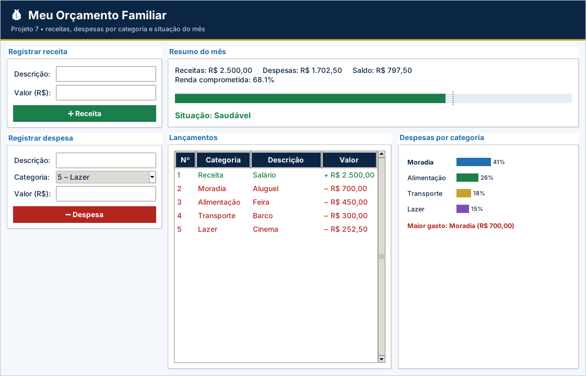

# Projeto 7 – Meu Orçamento Familiar (versão gráfica)

| **Ficha do projeto** |  |
| --- | --- |
| **Tema** | Controle de receitas e despesas por categoria |
| **Nível** | ★★☆☆☆ |
| **Tempo sugerido** | 6 a 8 horas |
| **Forma de trabalho** | individual ou dupla |
| **Aulas relacionadas** | Aulas 1 a 14 |
| **Conteúdos** | listas, dicionários, listas de dicionários, strings, `for/range`, decisões e validações |
| **Interface** | Tela em `tkinter` (já pronta) + `logica.py` para você implementar |

> Este projeto usa as **mesmas regras** do projeto [7](../../projetos-integradores/projeto-07-meu-orcamento-familiar/) em modo texto, agora com **janela gráfica** para rodar no VS Code. A tela já vem pronta; **você escreve a lógica** e os testes dizem se está certo.

## Cenário

Muitas famílias não sabem **para onde vai o dinheiro** no fim do mês. Você vai criar o **Meu Orçamento Familiar**, um programa em que a pessoa registra suas **receitas** e **despesas por categoria**, e o sistema mostra o **saldo**, a **porcentagem da renda comprometida**, o **gasto por categoria** e qual categoria pesa mais.

Todos os valores usados nos testes são **fictícios**.

## Objetivos de aprendizagem

Ao concluir este projeto, você será capaz de:

- Guardar lançamentos em uma **lista de dicionários**.
- Usar uma **lista de categorias** e um **dicionário** de totais.
- Percorrer listas com `for` e `range(len(...))`.
- Calcular totais, saldos e porcentagens.
- Padronizar textos e validar entradas.

## Dados de partida

| **Nº** | **Categoria de despesa** | **Exemplo** |
| --- | --- | --- |
| 1 | Moradia | aluguel, energia, água |
| 2 | Alimentação | feira, mercado |
| 3 | Transporte | barco, ônibus, combustível |
| 4 | Saúde | consulta, remédio |
| 5 | Lazer | cinema, passeio |
| 6 | Outros | demais gastos |

## Requisitos funcionais

| **Código** | **Requisito** |
| --- | --- |
| RF01 | **Menu**: 1 – Registrar receita, 2 – Registrar despesa, 3 – Resumo do mês, 4 – Despesas por categoria, 5 – Listar lançamentos, 0 – Sair. |
| RF02 | **Receita**: pedir descrição e valor e guardar o lançamento (tipo “receita”). |
| RF03 | **Despesa**: pedir descrição, **categoria (pelo número)** e valor e guardar o lançamento (tipo “despesa”). |
| RF04 | **Resumo**: total de receitas, total de despesas, saldo, **porcentagem da renda comprometida** e a situação do orçamento. |
| RF05 | **Despesas por categoria**: total de cada categoria com despesas, a **porcentagem** em relação ao total de despesas e a **categoria de maior gasto**. |
| RF06 | **Listar** todos os lançamentos, numerados, com categoria, descrição, sinal (+ ou −) e valor. |

> Na versão gráfica, os requisitos sobre **menu, `input()` e `print()`** são atendidos pela tela pronta (`app.py`). O seu foco são as **funções de lógica** listadas mais abaixo.

## Regras de negócio

| **Código** | **Regra** |
| --- | --- |
| RN01 | A descrição não pode ser vazia; padronize com `strip()` e `capitalize()`. |
| RN02 | O valor deve ser **maior que zero**; caso contrário, pedir de novo. |
| RN03 | A categoria deve ser um número de **1 a 6**; caso contrário, pedir de novo. Receitas usam a categoria “Receita”. |
| RN04 | Comprometimento = despesas ÷ receitas × 100. **Até 70%**: “Saudável”. **Mais de 70% até 100%**: “Atenção – despesas altas”. **Acima de 100%**: “Alerta – despesas maiores que a receita”. |
| RN05 | Sem receitas registradas, o resumo mostra os totais e avisa “Registre ao menos uma receita para analisar o orçamento.” (sem dividir por zero). |
| RN06 | Sem despesas ou sem lançamentos, as opções 4 e 5 avisam, sem gerar erro. |

## A parte gráfica (já pronta)

Formulários de receita e despesa, medidor de renda comprometida, tabela de lançamentos e gráfico por categoria.

Arquivos da pasta:

| Arquivo | Para que serve | Você altera? |
| --- | --- | --- |
| `app.py` | Monta a janela (botões, tabelas, gráficos) e chama a lógica | Não (só nos desafios extras) |
| `logica.py` | **Regras de negócio** do projeto | **Sim – é o seu trabalho** |
| `testes_logica.py` | Testes automáticos da lógica | Não |
| `ui_comum.py` | Cores, botões e utilitários de tela | Não |

## O que você vai implementar

Abra `logica.py`. Cada função abaixo começa com `raise NotImplementedError(...)`: apague essa linha e escreva a solução. Quando uma regra for violada, use `raise ValueError("mensagem")`: a tela mostra a mensagem em uma janela de aviso.

| Função | O que deve fazer |
| --- | --- |
| `novo_lancamento(tipo, descricao, valor, numero_categoria)` | RF02, RF03, RN01, RN02 e RN03: valida e devolve o dicionário do lançamento. |
| `totais(lancamentos)` | RF04: retorna (receitas, despesas, saldo) — somas arredondadas em 2 casas. |
| `percentual_comprometido(receitas, despesas)` | RN04 e RN05: despesas ÷ receitas × 100. Sem receitas (0), retorna None (sem dividir por zero). |
| `situacao_orcamento(percentual)` | RN04: até 70 -> 'Saudável'; acima de 70 até 100 -> 'Atenção – despesas altas'; |
| `despesas_por_categoria(lancamentos)` | RF05: dicionário {categoria: total} só com as categorias que têm despesas (ordem de CATEGORIAS). |
| `categoria_maior_gasto(por_categoria)` | RF05: retorna (categoria, total) do maior gasto. Dicionário vazio: ('', 0.0). |
| `percentuais_por_categoria(por_categoria)` | RF05: {categoria: % do total de despesas}. Dicionário vazio -> {}. |

## Como executar no VS Code

1. Abra **a pasta deste projeto** no VS Code (*File → Open Folder*).
2. Abra o terminal (`Ctrl + '`) e confira o `tkinter`: `python -m tkinter` abre uma janelinha de teste.
3. Rode os testes e veja o que falta: `python -m unittest -v testes_logica.py`
4. Implemente uma função por vez e repita o passo 3 até aparecer **OK**.
5. Abra a tela: `python app.py` e use o programa de verdade.

> No Linux, se faltar o `tkinter`: `sudo apt install python3-tk`. No Windows e no macOS ele já vem com o Python do python.org.

## O que entregar

- A pasta do projeto com `logica.py` completo (e `app.py`, se você fez desafios extras).
- Uma **captura de tela** do programa em uso.
- O resultado do comando `python -m unittest -v testes_logica.py`.
- Para projetos com arquivo (4, 5, 9 e 10): mostre que os dados continuam ao fechar e abrir a tela de novo.

## Critérios de avaliação

Sua entrega é avaliada em três níveis (**Pleno**, **Parcial** ou **Insuficiente**) nos critérios abaixo. O que significa o nível **Pleno**:

- **Funcionamento:** Os 6 testes passam e os gráficos acompanham os lançamentos.
- **Estruturas de dados:** Lista de dicionários e dicionário de totais corretos.
- **Regras de negócio:** RN01–RN06 atendidas (limites 70 e 100 inclusivos).
- **Validação:** Descrição, valor e categoria validados.
- **Organização:** Legível e comentado.

## Desafios extras (opcionais)

- **Gráfico de pizza** das despesas por categoria (`create_arc`).
- **Meta de poupança:** peça uma meta e mostre se o saldo a atingiu.
- **Remover lançamento:** apague a linha selecionada na tabela.
