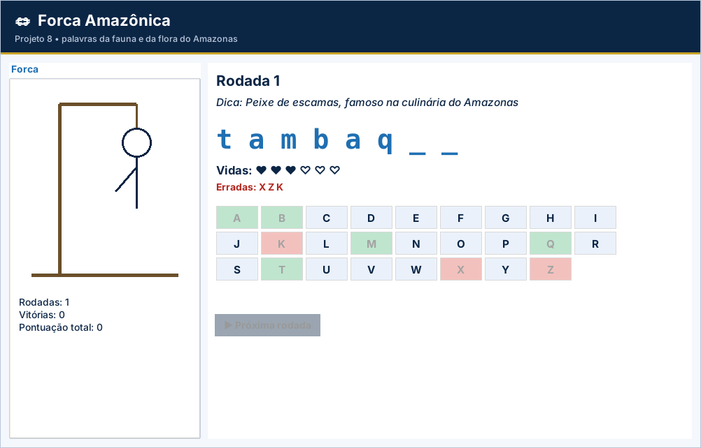

# Projeto 8 – Forca Amazônica (versão gráfica)

| **Ficha do projeto** |  |
| --- | --- |
| **Tema** | Jogo da forca com palavras da fauna e da flora regionais |
| **Nível** | ★★★☆☆ |
| **Tempo sugerido** | 8 a 10 horas |
| **Forma de trabalho** | dupla |
| **Aulas relacionadas** | Aulas 1 a 16 |
| **Conteúdos** | funções com parâmetros e retorno, tuplas, listas, strings, laços e decisões |
| **Interface** | Tela em `tkinter` (já pronta) + `logica.py` para você implementar |

> Este projeto usa as **mesmas regras** do projeto [8](../../projetos-integradores/projeto-08-forca-amazonica/) em modo texto, agora com **janela gráfica** para rodar no VS Code. A tela já vem pronta; **você escreve a lógica** e os testes dizem se está certo.

## Cenário

Uma escola quer um **jogo da forca** para treinar o vocabulário sobre a **fauna e a flora da Amazônia**. O jogador tem **6 vidas**, tenta descobrir a palavra letra por letra e acumula pontos ao longo das rodadas.

O código deve ser organizado em **funções**, cada uma com uma responsabilidade clara.

## Objetivos de aprendizagem

Ao concluir este projeto, você será capaz de:

- Criar e combinar **funções** com parâmetros e retorno (inclusive retornando mais de um valor).
- Usar **tuplas** (palavra e dica) e **listas** (letras acertadas e erradas).
- Manipular **strings** (`lower`, `strip`, `isalpha`, percorrer letras).
- Controlar rodadas com `while` e pontuação acumulada.

## Dados de partida

| **Rodada** | **Palavra** | **Dica** |
| --- | --- | --- |
| 1 | tambaqui | Peixe de escamas, famoso na culinária do Amazonas |
| 2 | pirarucu | Um dos maiores peixes de água doce, pode passar de 2 metros |
| 3 | tucunare | Peixe de rios e lagos, muito procurado na pesca esportiva |
| 4 | castanha | Semente de árvore gigante, também chamada castanha-do-pará |
| 5 | cupuacu | Fruta de polpa cremosa, usada em sucos e doces |
| 6 | jaraqui | Peixe pequeno e muito consumido pelos manauaras |

## Requisitos funcionais

| **Código** | **Requisito** |
| --- | --- |
| RF01 | Guardar as palavras e dicas em uma **tupla de tuplas** `PALAVRAS` (sem acentos, como na tabela). |
| RF02 | Função `escolher_palavra(numero_rodada)`: devolve a palavra e a dica da rodada (a rodada 7 volta à palavra da rodada 1). |
| RF03 | Função `montar_exibicao(palavra, acertadas)`: devolve o texto da palavra com `_` nas letras ainda não descobertas (ex.: `t a _ b _ q _ i`). |
| RF04 | Função `venceu(palavra, acertadas)`: devolve `True` se todas as letras foram descobertas. |
| RF05 | Função `ler_letra(tentadas)`: lê e valida uma letra, repetindo a pergunta até receber uma entrada válida. |
| RF06 | Função `jogar_rodada(numero_rodada)`: executa uma rodada e devolve `(ganhou, pontos)`. |
| RF07 | Função `principal()`: controla as rodadas, mantém o **placar** (pontos e vitórias) e pergunta “Jogar outra rodada? (s/n)”. |

> Na versão gráfica, os requisitos sobre **menu, `input()` e `print()`** são atendidos pela tela pronta (`app.py`). O seu foco são as **funções de lógica** listadas mais abaixo.

## Regras de negócio

| **Código** | **Regra** |
| --- | --- |
| RN01 | O jogador começa cada rodada com **6 vidas**; cada letra errada tira uma vida. Com 0 vidas, a rodada termina em derrota. |
| RN02 | A letra digitada é padronizada com `strip()` e `lower()`. Só vale **uma letra** de “a” a “z”. |
| RN03 | Letra **já tentada** (certa ou errada): avisar e pedir outra, **sem perder vida**. |
| RN04 | Vitória: pontos da rodada = **10 + 5 × vidas restantes**. Derrota: **0 ponto**. |
| RN05 | A cada rodada, mostrar a dica, a palavra parcial, as vidas e as letras erradas. |
| RN06 | Ao encerrar, mostrar o número de rodadas, vitórias e pontuação total. |

## A parte gráfica (já pronta)

Forca desenhada no Canvas, teclado A–Z clicável (ou digitado), dica, vidas e placar.

Arquivos da pasta:

| Arquivo | Para que serve | Você altera? |
| --- | --- | --- |
| `app.py` | Monta a janela (botões, tabelas, gráficos) e chama a lógica | Não (só nos desafios extras) |
| `logica.py` | **Regras de negócio** do projeto | **Sim – é o seu trabalho** |
| `testes_logica.py` | Testes automáticos da lógica | Não |
| `ui_comum.py` | Cores, botões e utilitários de tela | Não |

## O que você vai implementar

Abra `logica.py`. Cada função abaixo começa com `raise NotImplementedError(...)`: apague essa linha e escreva a solução. Quando uma regra for violada, use `raise ValueError("mensagem")`: a tela mostra a mensagem em uma janela de aviso.

| Função | O que deve fazer |
| --- | --- |
| `escolher_palavra(numero_rodada)` | Retorna a tupla (palavra, dica) da rodada (1, 2, 3...). Depois da última, volta à primeira. |
| `validar_letra(texto, tentadas)` | RN02 e RN03: retorna a letra em minúscula. |
| `montar_exibicao(palavra, acertadas)` | RN05: letras acertadas aparecem e as demais viram '_', separadas por espaço. |
| `venceu(palavra, acertadas)` | True quando TODAS as letras da palavra já foram acertadas. |
| `vidas_restantes(erradas)` | RN01: MAX_ERROS menos a quantidade de letras erradas. |
| `pontos_da_rodada(vitoria, vidas)` | RN04: vitória = 10 + 5 × vidas restantes; derrota = 0. |
| `jogar_letra(palavra, letra, acertadas, erradas)` | Registra a jogada: coloca a letra em 'acertadas' ou em 'erradas'. Retorna True se acertou. |

## Como executar no VS Code

1. Abra **a pasta deste projeto** no VS Code (*File → Open Folder*).
2. Abra o terminal (`Ctrl + '`) e confira o `tkinter`: `python -m tkinter` abre uma janelinha de teste.
3. Rode os testes e veja o que falta: `python -m unittest -v testes_logica.py`
4. Implemente uma função por vez e repita o passo 3 até aparecer **OK**.
5. Abra a tela: `python app.py` e use o programa de verdade.

> No Linux, se faltar o `tkinter`: `sudo apt install python3-tk`. No Windows e no macOS ele já vem com o Python do python.org.

## O que entregar

- A pasta do projeto com `logica.py` completo (e `app.py`, se você fez desafios extras).
- Uma **captura de tela** do programa em uso.
- O resultado do comando `python -m unittest -v testes_logica.py`.
- Para projetos com arquivo (4, 5, 9 e 10): mostre que os dados continuam ao fechar e abrir a tela de novo.

## Critérios de avaliação

Sua entrega é avaliada em três níveis (**Pleno**, **Parcial** ou **Insuficiente**) nos critérios abaixo. O que significa o nível **Pleno**:

- **Funcionamento:** Os 7 testes passam e uma rodada completa funciona.
- **Funções:** Cada função com uma responsabilidade e retorno correto.
- **Strings e listas:** Letras tratadas com `lower`, `strip` e listas.
- **Regras de negócio:** Vidas, repetição e pontos corretos.
- **Organização:** Legível e comentado.

## Desafios extras (opcionais)

- **Temas:** `Combobox` para escolher peixes, frutas ou animais.
- **Dica extra:** botão que revela uma letra ao custo de uma vida.
- **Placar em arquivo:** guarde o recorde em `recorde.txt`.
