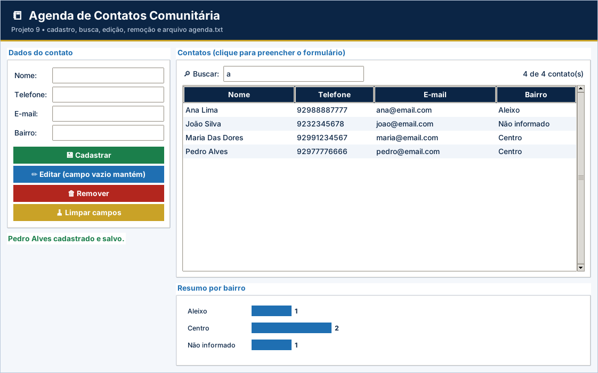

# Projeto 9 – Agenda de Contatos Comunitária (versão gráfica)

| **Ficha do projeto** |  |
| --- | --- |
| **Tema** | Cadastro com busca, edição, remoção e persistência |
| **Nível** | ★★★★☆ |
| **Tempo sugerido** | 10 a 12 horas |
| **Forma de trabalho** | dupla |
| **Aulas relacionadas** | Aulas 1 a 17 |
| **Conteúdos** | funções, listas de dicionários, strings, validações, arquivos `.txt`, busca, edição e remoção |
| **Interface** | Tela em `tkinter` (já pronta) + `logica.py` para você implementar |

> Este projeto usa as **mesmas regras** do projeto [9](../../projetos-integradores/projeto-09-agenda-de-contatos-comunitaria/) em modo texto, agora com **janela gráfica** para rodar no VS Code. A tela já vem pronta; **você escreve a lógica** e os testes dizem se está certo.

## Cenário

A associação de moradores de um bairro de Manaus quer uma **agenda de contatos** digital para localizar rapidamente vizinhos, comerciantes e serviços. O sistema deve permitir **cadastrar, listar em ordem alfabética, buscar por parte do nome, editar e remover** contatos, e **guardar tudo em arquivo**.

Use apenas dados **fictícios** nos testes.

## Objetivos de aprendizagem

Ao concluir este projeto, você será capaz de:

- Implementar as operações de um **CRUD** (criar, ler, atualizar e remover).
- Persistir uma lista de dicionários em **arquivo** `.txt`.
- Validar telefone e e-mail com funções de **string**.
- Organizar o sistema em **funções**.

## Dados de partida

| **Campo** | **Exemplo** | **Regra** |
| --- | --- | --- |
| nome | Maria Das Dores | obrigatório, único, padronizado com `title()` |
| telefone | 92991234567 | só dígitos, 10 ou 11 (com DDD) |
| email | maria@email.com | contém “@” e “.” e não tem espaços |
| bairro | Centro | opcional; se vazio, “Não informado” |

## Requisitos funcionais

| **Código** | **Requisito** |
| --- | --- |
| RF01 | Ao iniciar, **carregar** os contatos de `agenda.txt` (arquivo inexistente = agenda vazia). |
| RF02 | **Menu**: 1 – Cadastrar, 2 – Listar, 3 – Buscar por trecho do nome, 4 – Editar, 5 – Remover, 6 – Resumo por bairro, 0 – Sair. |
| RF03 | **Cadastrar** contato (nome, telefone, e-mail e bairro) e salvar no arquivo. |
| RF04 | **Listar** todos os contatos em **ordem alfabética** pelo nome. |
| RF05 | **Buscar** contatos cujo nome **contenha** o trecho digitado, sem diferenciar maiúsculas de minúsculas. |
| RF06 | **Editar** telefone, e-mail e bairro de um contato: **Enter em branco mantém** o valor atual. Salvar após a edição. |
| RF07 | **Remover** um contato após **confirmação** (s/n) e salvar. |
| RF08 | **Resumo por bairro**: quantos contatos há em cada bairro (use um dicionário contador). |

> Na versão gráfica, os requisitos sobre **menu, `input()` e `print()`** são atendidos pela tela pronta (`app.py`). O seu foco são as **funções de lógica** listadas mais abaixo.

## Regras de negócio

| **Código** | **Regra** |
| --- | --- |
| RN01 | Nome padronizado com `strip()` e `title()`; **não vazio, sem “;” e sem repetição** na agenda. |
| RN02 | Telefone: remover espaços, hífens e parênteses; aceitar **somente dígitos com 10 ou 11 caracteres**. Inválido: pedir de novo (no cadastro) ou **manter o valor anterior** (na edição). |
| RN03 | E-mail: converter para minúsculas; deve conter “@” e “.”, **não** conter espaços nem “;”. |
| RN04 | Bairro: padronizar com `title()`, remover “;” e usar “Não informado” se vazio. |
| RN05 | Busca, edição e remoção por nome inexistente: avisar “Contato não encontrado.” sem erro. |
| RN06 | Os dados devem **permanecer** ao fechar e reabrir o programa. |

## A parte gráfica (já pronta)

Formulário, lista com busca em tempo real, edição, remoção com confirmação e resumo por bairro.

Arquivos da pasta:

| Arquivo | Para que serve | Você altera? |
| --- | --- | --- |
| `app.py` | Monta a janela (botões, tabelas, gráficos) e chama a lógica | Não (só nos desafios extras) |
| `logica.py` | **Regras de negócio** do projeto | **Sim – é o seu trabalho** |
| `testes_logica.py` | Testes automáticos da lógica | Não |
| `ui_comum.py` | Cores, botões e utilitários de tela | Não |

## O que você vai implementar

Abra `logica.py`. Cada função abaixo começa com `raise NotImplementedError(...)`: apague essa linha e escreva a solução. Quando uma regra for violada, use `raise ValueError("mensagem")`: a tela mostra a mensagem em uma janela de aviso.

| Função | O que deve fazer |
| --- | --- |
| `padronizar_nome(nome)` | RN01: strip() + title(). |
| `limpar_telefone(texto)` | RN02: remove espaços, hífens e parênteses. '(92) 99123-4567' -> '92991234567'. |
| `telefone_valido(telefone)` | RN02: somente dígitos, com 10 ou 11 caracteres (telefone já limpo). |
| `email_valido(email)` | RN03: contém '@' e '.', e não contém espaços nem ';'. |
| `padronizar_bairro(bairro)` | RN04: title(), remove ';' e usa 'Não informado' se ficar vazio. |
| `buscar_contato(contatos, nome)` | Retorna o contato com esse nome exato (após padronizar) ou None. |
| `cadastrar_contato(contatos, nome, telefone, email, bairro)` | RF03, RN01–RN04: valida, acrescenta e retorna o contato. |
| `listar_ordenado(contatos)` | RF04: nova lista com os contatos em ordem alfabética pelo nome. |
| `buscar_por_trecho(contatos, trecho)` | RF05: contatos cujo nome CONTÉM o trecho, sem diferenciar maiúsculas (em ordem alfabética). |
| `editar_contato(contatos, nome, telefone, email, bairro)` | RF06 e RN02: edita telefone, e-mail e bairro. Campo em branco MANTÉM o valor atual. |
| `remover_contato(contatos, nome)` | RF07 e RN05: remove o contato. Inexistente: ValueError("Contato não encontrado."). |
| `resumo_por_bairro(contatos)` | RF08: dicionário contador {bairro: quantidade}. |
| `salvar_contatos(contatos, arquivo)` | RF03 e RN06: grava TODOS os contatos (modo 'w', utf-8): nome;telefone;email;bairro. |
| `carregar_contatos(arquivo)` | RF01: lê o arquivo e retorna a lista de contatos. Inexistente -> lista vazia. |

## Como executar no VS Code

1. Abra **a pasta deste projeto** no VS Code (*File → Open Folder*).
2. Abra o terminal (`Ctrl + '`) e confira o `tkinter`: `python -m tkinter` abre uma janelinha de teste.
3. Rode os testes e veja o que falta: `python -m unittest -v testes_logica.py`
4. Implemente uma função por vez e repita o passo 3 até aparecer **OK**.
5. Abra a tela: `python app.py` e use o programa de verdade.

> No Linux, se faltar o `tkinter`: `sudo apt install python3-tk`. No Windows e no macOS ele já vem com o Python do python.org.

## O que entregar

- A pasta do projeto com `logica.py` completo (e `app.py`, se você fez desafios extras).
- Uma **captura de tela** do programa em uso.
- O resultado do comando `python -m unittest -v testes_logica.py`.
- Para projetos com arquivo (4, 5, 9 e 10): mostre que os dados continuam ao fechar e abrir a tela de novo.

## Critérios de avaliação

Sua entrega é avaliada em três níveis (**Pleno**, **Parcial** ou **Insuficiente**) nos critérios abaixo. O que significa o nível **Pleno**:

- **Funcionamento:** Os 9 testes passam e a tela mantém os dados ao reabrir.
- **Arquivos:** Salva tudo (`"w"`) e carrega com `strip()` e `split`.
- **Validações:** Nome, telefone e e-mail conforme RN01–RN04.
- **Busca, edição e remoção:** Funcionam e salvam após a alteração.
- **Organização:** Legível e comentado.

## Desafios extras (opcionais)

- **Exportar CSV:** botão que grava `agenda.csv` com cabeçalho.
- **Telefone repetido:** impeça dois contatos com o mesmo telefone.
- **Backup:** copie a agenda para `agenda_backup.txt` antes de cada remoção.
