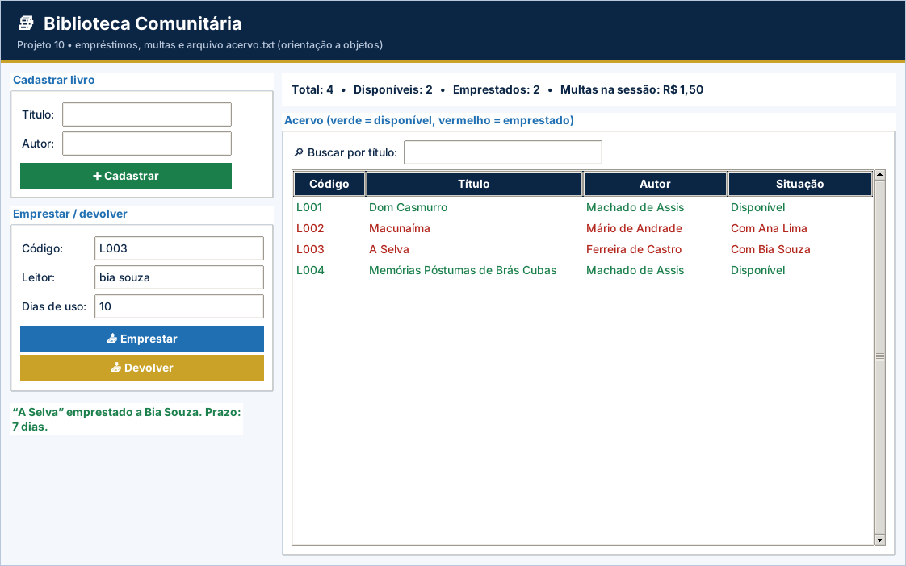

# Projeto 10 – Biblioteca Comunitária (versão gráfica)

| **Ficha do projeto** |  |
| --- | --- |
| **Tema** | Sistema de empréstimos orientado a objetos |
| **Nível** | ★★★★★ |
| **Tempo sugerido** | 12 a 16 horas |
| **Forma de trabalho** | dupla |
| **Aulas relacionadas** | Aulas 1 a 19 |
| **Conteúdos** | classes e objetos que colaboram entre si, dicionário de objetos, arquivos, validações e regras de negócio |
| **Interface** | Tela em `tkinter` (já pronta) + `logica.py` para você implementar |

> Este projeto usa as **mesmas regras** do projeto [10](../../projetos-integradores/projeto-10-biblioteca-comunitaria/) em modo texto, agora com **janela gráfica** para rodar no VS Code. A tela já vem pronta; **você escreve a lógica** e os testes dizem se está certo.

## Cenário

Uma biblioteca comunitária ribeirinha controla empréstimos em um caderno e vive perdendo livros e prazos. Você vai desenvolver o **sistema da Biblioteca Comunitária**, usando **duas classes que colaboram**: `Livro` (cada exemplar) e `Biblioteca` (o acervo e as operações). O sistema controla **empréstimos, devoluções e multas por atraso**, e guarda o acervo em arquivo.

Este é um projeto de **fechamento do curso**, no nível do Projeto 5. Multas e prazos são **fictícios**.

## Objetivos de aprendizagem

Ao concluir este projeto, você será capaz de:

- Modelar o problema com **duas classes que se relacionam**.
- Guardar objetos em um **dicionário** (`codigo → Livro`).
- Aplicar **regras de negócio** (prazo, multa e limite de empréstimos).
- Persistir o acervo em **arquivo** e recarregá-lo.
- Devolver **tuplas** `(sucesso, mensagem)` para separar a lógica da interface.

## Dados de partida

| **Código** | **Título (acervo inicial)** | **Autor** |
| --- | --- | --- |
| L001 | Dom Casmurro | Machado de Assis |
| L002 | Macunaíma | Mário de Andrade |
| L003 | A Selva | Ferreira de Castro |
| L004 | Memórias Póstumas de Brás Cubas | Machado de Assis |

## Requisitos funcionais

| **Código** | **Requisito** |
| --- | --- |
| RF01 | Classe `Livro` com atributos `codigo`, `titulo`, `autor` e `leitor` (texto vazio = disponível) e métodos `esta_disponivel()`, `emprestar(leitor)`, `devolver(dias)` (devolve a multa) e `descricao()`. |
| RF02 | Classe `Biblioteca` com o dicionário `livros` e os métodos `adicionar(titulo, autor)`, `buscar(codigo)`, `buscar_por_titulo(trecho)`, `emprestar(codigo, leitor)`, `devolver(codigo, dias)`, `salvar()` e `carregar()`. |
| RF03 | Na **primeira execução** (sem arquivo), criar o **acervo inicial** da tabela e salvá-lo em `acervo.txt`; nas seguintes, **carregar** o arquivo. |
| RF04 | **Menu**: 1 – Cadastrar livro, 2 – Listar acervo, 3 – Buscar por título, 4 – Emprestar, 5 – Devolver, 6 – Relatório, 0 – Sair. |
| RF05 | **Emprestar** e **devolver** devolvem uma tupla `(sucesso, mensagem)`, que o menu apenas exibe. |
| RF06 | **Relatório**: total de livros, disponíveis, emprestados e **total de multas** arrecadadas na sessão. |
| RF07 | Salvar o acervo **após cada operação** que o altere (cadastro, empréstimo e devolução). |

> Na versão gráfica, os requisitos sobre **menu, `input()` e `print()`** são atendidos pela tela pronta (`app.py`). O seu foco são as **funções de lógica** listadas mais abaixo.

## Regras de negócio

| **Código** | **Regra** |
| --- | --- |
| RN01 | O **código** é gerado automaticamente no formato `L001`, `L002`... (sequência do acervo). |
| RN02 | Título e autor **não vazios** e sem “;”; padronize com `strip()` e `title()` no cadastro. |
| RN03 | **Prazo** de empréstimo: **7 dias**. Atraso: **R$ 0,50 por dia** que passar do prazo (devolução em até 7 dias: sem multa). |
| RN04 | Um leitor pode ter **no máximo 3** livros emprestados ao mesmo tempo. |
| RN05 | Não é possível emprestar livro **inexistente** ou **já emprestado** (informar com quem está), nem devolver livro **não emprestado**. |
| RN06 | O nome do leitor é padronizado com `strip()` e `title()` e **não pode ser vazio**. Os dias de uso devem ser **maiores que zero**. |
| RN07 | Busca por título: o trecho **pode estar em qualquer parte** do título, sem diferenciar maiúsculas de minúsculas. |

## A parte gráfica (já pronta)

Acervo colorido (disponível/emprestado), busca por título, empréstimo, devolução com multa e relatório.

Arquivos da pasta:

| Arquivo | Para que serve | Você altera? |
| --- | --- | --- |
| `app.py` | Monta a janela (botões, tabelas, gráficos) e chama a lógica | Não (só nos desafios extras) |
| `logica.py` | **Regras de negócio** do projeto | **Sim – é o seu trabalho** |
| `testes_logica.py` | Testes automáticos da lógica | Não |
| `ui_comum.py` | Cores, botões e utilitários de tela | Não |

## O que você vai implementar

Abra `logica.py`. Cada função abaixo começa com `raise NotImplementedError(...)`: apague essa linha e escreva a solução. Quando uma regra for violada, use `raise ValueError("mensagem")`: a tela mostra a mensagem em uma janela de aviso.

| Função | O que deve fazer |
| --- | --- |
| `Livro.esta_disponivel()` | True quando ninguém está com o livro (leitor vazio). |
| `Livro.emprestar(leitor)` | Registra o leitor que levou o livro. |
| `Livro.devolver(dias)` | RN03: limpa o leitor e devolve a multa (R$ 0,50 por dia além de 7; até 7 dias = 0). |
| `Livro.descricao()` | Texto 'L001 | Título | Autor | Disponível' (ou 'Emprestado a Fulano'). |
| `Biblioteca.adicionar(titulo, autor)` | RF02, RN01 e RN02: cadastra o livro com código automático (L001, L002...) e salva. |
| `Biblioteca.buscar(codigo)` | Retorna o Livro do código (qualquer caixa) ou None. |
| `Biblioteca.buscar_por_titulo(trecho)` | RN07: livros cujo título CONTÉM o trecho (sem diferenciar maiúsculas), na ordem do acervo. |
| `Biblioteca.emprestimos_do_leitor(leitor)` | Quantidade de livros que o leitor (nome já padronizado) está com ele agora. |
| `Biblioteca.emprestar(codigo, leitor)` | RF05, RN04, RN05 e RN06: retorna (sucesso, mensagem). Salva se der certo. |
| `Biblioteca.devolver(codigo, dias)` | RF05, RN03, RN05 e RN06: retorna (sucesso, mensagem). Soma a multa em total_multas. |
| `Biblioteca.relatorio()` | RF06: dicionário com 'total', 'disponiveis', 'emprestados' e 'multas'. |
| `Biblioteca.salvar()` | RF07: grava uma linha  codigo;titulo;autor;leitor  por livro (leitor vazio = disponível). |
| `Biblioteca.carregar()` | RF03: lê o arquivo e recria os objetos Livro em self.livros. |

## Como executar no VS Code

1. Abra **a pasta deste projeto** no VS Code (*File → Open Folder*).
2. Abra o terminal (`Ctrl + '`) e confira o `tkinter`: `python -m tkinter` abre uma janelinha de teste.
3. Rode os testes e veja o que falta: `python -m unittest -v testes_logica.py`
4. Implemente uma função por vez e repita o passo 3 até aparecer **OK**.
5. Abra a tela: `python app.py` e use o programa de verdade.

> No Linux, se faltar o `tkinter`: `sudo apt install python3-tk`. No Windows e no macOS ele já vem com o Python do python.org.

## O que entregar

- A pasta do projeto com `logica.py` completo (e `app.py`, se você fez desafios extras).
- Uma **captura de tela** do programa em uso.
- O resultado do comando `python -m unittest -v testes_logica.py`.
- Para projetos com arquivo (4, 5, 9 e 10): mostre que os dados continuam ao fechar e abrir a tela de novo.

## Critérios de avaliação

Sua entrega é avaliada em três níveis (**Pleno**, **Parcial** ou **Insuficiente**) nos critérios abaixo. O que significa o nível **Pleno**:

- **Funcionamento:** Os 10 testes passam e a tela conclui empréstimo e devolução.
- **Orientação a objetos:** `Livro` e `Biblioteca` colaboram, com responsabilidades claras.
- **Regras de negócio:** Prazo, multa, limite e mensagens corretos.
- **Persistência:** Salva a cada operação e carrega ao iniciar.
- **Organização:** Legível e comentado.

## Desafios extras (opcionais)

- **Classe Leitor:** crie `Leitor` com nome e livros em posse.
- **Reserva:** permita reservar livros emprestados e avisar na devolução.
- **Mais emprestados:** conte quantas vezes cada livro foi emprestado e mostre o ranking.
